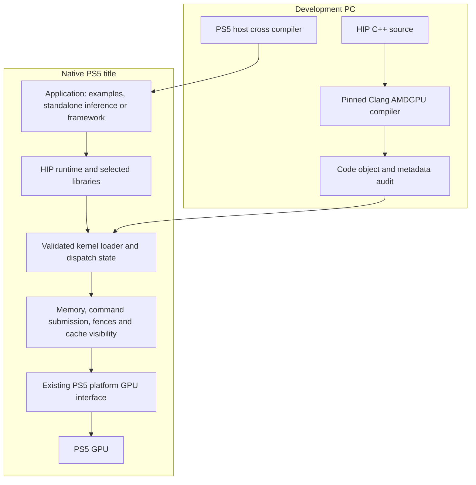

# Native HIP and ROCm capabilities on PlayStation 5

Updated: 2026-10-16, America/New_York.

## Active release priority: native LLM inference v1

The 2026-10-15 plan review in [LLM_V1_PLAN.md](LLM_V1_PLAN.md) defines M0-M5
within the original V1.1-V1.5 acceptance gates. Prioritize a linked native client
and executed operator inventory alongside QKV, then one layer and full logits.
M0, M1 and the bounded actual-model prefix are validated on .40. The next
priority is one whole transformer layer under M2: RoPE/KV, attention, output
projection/residual and FFN/residual, with milestone pushes. Position-zero
prefix validation does not close M2 or establish inference.

- 2026-10-16 | M2 whole layer | offline | 37 nodes, 512+reset2 host sequence, twelve resident owners, CPU reference and diagnostic numerical comparison pass | evidence/offline-model-layer-integration.json | next: native app and .40 validation

- 2026-10-16 | M2 actual-model prefix | 50df1fd | .40 | pass: tokens 0/1/2/31999 at position zero, embedding/norm/weighted/full QKV, 24 raw tensors and 36 launches, external model reused, normal cleanup | evidence/console40-model-prefix-success.json | next: complete-layer RoPE/KV/attention/residual/FFN; M2 remains open

- 2026-10-16 | M2 native prefix | .40 | failed: model/context loaded; public HIP rejected first GET_ROWS launch; healthy safety close | evidence/console40-model-prefix-launch-rejection.json | next: adapter admission fix

- 2026-10-16 | M2 actual-model prefix | offline | four real graphs, 36 mocked HIP dispatches, sanitized admission and repeatable CPU reference | evidence/offline-model-prefix-integration.json | next: native package and .40 numerical/lifecycle validation

- 2026-10-16 | M0 HIP calls | c988245 | .40 | pass:11 exact rows, guarded fill, clean lifecycle/postchecks | evidence/console40-native-hip-call-success.json | next: integrated M2 prefix

- 2026-10-16 | M0 HIP calls | offline | fresh runtime/client host qualification and 17 accounting/failure cases pass | evidence/offline-hip-call-qualification.json | next: native call snapshot on .40

- 2026-10-16 | Native scheduler lifecycle | d0fd5c4 | .40 | strict pass: external model/context/reuse, 213 balanced owners, clean stop and post-run checks | evidence/console40-native-scheduler-model-success.json | next: per-HIP-call qualification; M0 open

- 2026-10-16 | Build performance | offline | configurable parallel workers, native ccache with authenticated identities, consumed-input link validation | next: fresh prerequisite chain and native candidate; no inference advancement

- 2026-10-16 | M0 scheduler ownership | offline | 49 tests and six real lifecycle cases pass; paired aligned buffer, checked source adaptation | evidence/offline-native-scheduler-ownership.json | next: native package and .40

Direct native safetensors/PyTorch checkpoint loading is now an explicit
requirement in `LLM_V1_PLAN.md`. Desktop conversion does not satisfy it; readers
remain unimplemented. M0 and M1 are qualified; subsequent integrated
inference gates remain open.

- 2026-10-16 | External model load | 08857a6 | .40 | partial-pass: 21 MiB native app loads verified `/data/hip/models` weights; clean ownership/stop, prior heap warning persists | evidence/console40-native-external-model-load.json | next: scheduler malloc diagnosis

- 2026-10-16 | External model path update | offline | owner-selected `/data/hip/models/tinyllama-q4_0.gguf`; Make/CLI defaults and app configuration agree, 45 focused tests pass | next: fresh package and console validation

- 2026-10-16 | M0 external model storage | offline | persistent weights, Eden/Lapy access, verified upload/reuse and small app package contract | evidence/offline-external-model-storage.json | next: fresh package/audit and installed external-model validation; heap warning remains open

- 2026-10-16 | M0 model storage | 539802f | .40 | partial: full load/context/reuse,219 balanced owners; heap warning rejects clean gate | evidence/console40-native-model-load-partial.json | next: trace scheduler malloc

M1 now passed independently on .40: weighted normalization, shared Q8 and full
Q/K/V, with all raw buffers and clean lifecycle. M0's native application
boundary also passed; integrate M2's remaining layer operations next.

- 2026-10-16 | M0 model load | .40 | failed: 619094016-byte CPU allocation ENOMEM; healthy safety close | evidence/console40-native-model-allocation-failure.json | next: native allocation fix

- 2026-10-16 | M0 owned model storage | offline | pass: 16 suites/115 methods, 13 allocator scenarios and PS5 object compile; paired routing audit added | evidence/offline-native-model-host-storage.json | next: fresh native package and actual image audit

- 2026-10-16 | M0 aligned routing correction | offline | v5 audit failed its external-only assumption; corrected all selected pairs, 45-function diagnostic and 116 tests pass | evidence/offline-native-ggml-routing-correction.json | next: fresh v6 package; no native execution

- 2026-10-16 | M0 corrected deployment | .40 | pass: 22 readbacks, nine assets, recovery and healthy idle | evidence/console40-native-model-watchdog-fixed-deployment.json | next: native model/reuse

- 2026-10-16 | M0 recovery | offline | pass: historical deployed-image authentication, 41 tests and real baseline check | evidence/offline-historical-model-baseline.json | next: fresh package
- 2026-10-16 | M0 corrected package | offline | pass: 148 objects, 199 commands, 145 tests and real admission | evidence/offline-native-llm-model-watchdog-fixed-package.json | next: native model/reuse

- 2026-10-16 | M0 watchdog | offline | pass: 120s contract, 33 lifecycle cases, 30 related tests and CTest | evidence/offline-native-llm-watchdog-fix.json | next: fresh native package

- 2026-10-16 | M0 model test | .40 | failed: 120s request rejected by 60s watchdog ceiling; healthy safety close | evidence/console40-native-model-watchdog-failure.json | next: offline fix

- 2026-10-16 | M0 model deployment | .40 | pass: exact package/nine assets, recovery and healthy idle | evidence/console40-native-model-deployment.json | next: native execution

- 2026-10-16 | M0 model package | offline | pass: 148 objects, 199 commands, 139 tests and real admission | evidence/offline-native-llm-model-gate.json | next: installed model/reuse gate

- 2026-10-16 | M0 vocabulary | .40 | pass: installed tokenizer, HIP storage, synthetic rejection and natural lifecycle | evidence/console40-native-vocab-success.json | next: actual model/reuse gate

- 2026-10-16 | M0 model integration | offline | 134 tests and diagnostic relink pass; real upstream context cleanup added | evidence/offline-native-llm-model-link-correction.json | next: fresh package/audit

- 2026-10-16 | M0 model audit | offline | production source-path fix, 40 tests and 29-function diagnostic audit pass | evidence/offline-native-llm-audit-path-correction.json | next: full Make package

- 2026-10-16 | M0 vocabulary | .40 | failed: installed native startup/runtime passed, then pre-VOCAB invariant and watchdog quarantine; exact-title close restored healthy idle | evidence/console40-native-vocab-invariant-failure.json | next: offline assertion/path diagnosis; no replay or M0 completion

- 2026-10-16 | M0 path correction | offline | pass: post-elevation title asset paths, explicit failure diagnostics, 33 tests and independent review | evidence/offline-native-llm-asset-path-fix.json | next: fresh native package/audit and installed-title test

- 2026-10-16 | M0 corrected package | offline | pass: fresh 147-object app, 197 commands, 43 tests, 24-function audit and independent real freeze admission | evidence/offline-native-llm-asset-path-rebuild.json | next: fresh installed-title test; native correction remains unproven

- 2026-10-16 | M0 deployment prerequisite | .40/offline | deployment rejected before upload for missing results-directory ancestor; fixed bounded ancestor creation, independent review and 52 tests pass | evidence/console40-vocab-deploy-directory-failure.json | next: fresh candidate and installed-title validation; no application execution claimed

- 2026-10-15 | M0 prerequisites | offline | pass: source-only native payload link (71 objects, four checks) and vocabulary fixture (45 metadata fields, 32 tokenizer cases, six checks); independent reviews | evidence/offline-native-llm-client-link.json, evidence/offline-llm-vocab-fixture.json | next: native app and actual-client rejection; no native execution claimed

- 2026-10-16 | M0 application prerequisite | offline | pass: source-only installed-app package, 147 objects, 197 commands, 41 tests, 24-function image audit and independent real freeze admission | evidence/offline-native-llm-application.json | next: installed vocabulary title on .40, then actual-model rejection/reuse; no native execution claimed

- 2026-10-15 | M1 | 101744f | .40 | pass: 2048 weighted values, 2304 Q8 bytes, 2560 QKV values, 30 buffers and clean lifecycle | evidence/console40-public-weighted-qkv-success.json | next: M0 client, M2 layer

- 2026-10-15 | M0 CPU inventory | offline | pass: source-only Make, 512 positions, 14 operations, 16384000 finite logits, independent review | evidence/offline-llm-executed-graph.json | next: native app and backend routing

Per the owner's 2026-10-15 direction, follow [LLM_V1_PLAN.md](LLM_V1_PLAN.md)
for the first release: one native standalone Llama-family inference client,
Q4_0, batch one and a bounded 512-token context. Start client/model profiling,
then implement only the runtime and tensor capabilities that it demonstrates
are required. V1.1-V1.5 define implementation order and acceptance evidence.
Apply the v1 scope rule: every new capability must address a demonstrated client
blocker or release acceptance check. Full ROCm libraries and SDK coverage are
not prerequisites for this release.

General command-retirement diagnostics and G5 optimization are deferred unless
needed by that client. Do not require complete G5 or broad G6 coverage before
starting G7. Training, frameworks and the remaining G1-G12 objectives retain
their acceptance criteria on the longer-term roadmap. A v1 release will not
mark the full SDK goal complete. Historical next actions below are superseded.

- 2026-10-15 | release plan | owner decision | native LLM inference prioritized | LLM_V1_PLAN.md | next: V1.1 client/model profile

- 2026-10-15 | V1.1 partial | offline | CPU tools and quantization/RoPE tests passed; model metadata locked | evidence/offline-llm-v1-inputs.json | next: embedded-image registration, HIP compile/link probe, model conversion/reference fixtures

- 2026-10-15 | V1.1 partial | offline | full source weights/tokenizer downloaded and hash-verified; nine tooling tests passed | evidence/offline-llm-model-source.json | next: pinned conversion and CPU reference fixtures

See [LLM_V1_PROFILE.md](LLM_V1_PROFILE.md) for reproducible Make targets and
source-inspected blockers. Native inference remains unqualified.

- 2026-10-15 | V1.1 partial | offline | locked F16 and pure Q4_0 conversion verified; Q4_0 GGUF 619831552 bytes with 156 Q4_0 and 45 F32 tensors | evidence/offline-llm-model-conversion.json | next: CPU reference logits and native client prerequisites

- 2026-10-15 | V1.1 partial | CPU only | seven fixed prefill/decode cases repeated bitwise; 64-step and 512-token boundary cases; 334 full logit rows and 16 tooling tests pass | evidence/offline-llm-cpu-reference.json | next: native compiler launch and client-required operator/ABI coverage

- 2026-10-15 | V1.2 prerequisite | offline | genuine compiler aggregate arguments through CLR, eager/deferred and negative controls; 87-unit sanitizer qualification and 32 core regressions pass | evidence/offline-public-aggregate-arguments.json | next: native aggregate package and .40 validation

- 2026-10-15 | V1.3 prerequisite | offline CPU only | genuine RMSNorm reference, six cases/81920 values, independent review and fresh Make reproduction pass | evidence/offline-llm-rmsnorm-reference.json | next: actual operator resource admission and native numerical gate

- 2026-10-15 | V1.2 prerequisite | offline | nullable optional kernel pointers, 87-compilation CLR sanitizer qualification and 32 core regressions pass | evidence/offline-public-nullable-arguments.json | next: actual RMSNorm resource contract

- 2026-10-15 | V1.2 prerequisite | offline | actual RMSNorm resource/owned preparation and legacy reduction packets pass; 32 core regressions and native cross-build pass | evidence/offline-rmsnorm-resource-preparation.json | next: reproducible fixture and public CLR resource routing

- 2026-10-15 | V1.1/V1.3 prerequisite | offline | source-only unchanged RMSNorm module reproduced byte-for-byte through Make; complete ABI and independent provenance review pass | evidence/offline-rmsnorm-source-fixture.json | next: public CLR qualification and native numerical gate

- 2026-10-15 | V1.2 prerequisite | offline | public CLR RMSNorm resource routing, eager/deferred packet oracle, 87-compilation sanitizer suite and native aggregate cross-build pass | evidence/offline-public-clr-rmsnorm-resources.json | next: native numerical package and .40 validation

- 2026-10-15 | V1.3 candidate | offline | native RMSNorm package, image/asset audit and independent raw numerical controls pass | evidence/offline-native-public-rmsnorm-package.json | next: frozen .40 numerical validation

- 2026-10-15 | V1.3 bounded operator | 6265eda | .40 | pass: upstream RMSNorm, six cases/81920 values, raw-buffer verification and clean lifecycle | evidence/console40-public-rmsnorm-success.json | next: client-required Q4_0 multiplication/link blockers, layer integration, full-model inference

- 2026-10-15 | V1.1/V1.3 integration probe | offline | selected Q8_1 links and modern hipBLAS interface syntax passes | docs/LLM_Q4_PATH.md | next: source-only integration and real Q4_0 resource/numerical gates

- 2026-10-15 | V1.1/V1.3 prerequisite | offline | source-built selected Q8_1/Q4_0 modules and isolated modern header adaptation pass | evidence/offline-llm-q4-source-fixture.json | next: actual public HIP ABI/resource routing and native numerical gates

- 2026-10-15 | V1.3 candidate | offline | native Q4 package and three-image audit pass; 86 control tests pass | evidence/offline-native-public-q4-package.json | next: freeze and .40 numerical validation

- 2026-10-15 | V1.3 | 1abebce | .40 | failed: first Q4 numeric output; four standalone Q8 cases passed; safety-close/health/locks verified | evidence/console40-public-q4-failure.json | next: offline ISA/raw diagnosis

- 2026-10-15 | V1.3 diagnosis | offline | four-byte address-rounddown model reproduces failed Q4 output exactly; halfword-load variant compiles with unchanged ABI but changed resources | evidence/offline-q4-alignment-diagnosis.json | next: reviewed alignment diagnostic, no hardware fix claimed

- 2026-10-15 | V1.3 prerequisite | offline | exact c3/c4 Q4 core admission; original/halfword objects pass packet and owned preparation, 61 checks pass; one unrelated old reduction receipt rejected | evidence/offline-q4-c4-admission.json | next: authenticated native diagnostic, no GPU qualification claimed

- 2026-10-15 | V1.3 diagnostic | offline | authenticated halfword fixture, unchanged 56 numerical assets, original/diagnostic public HIP models and independently extracted native package pass | evidence/offline-native-q4-halfword-package.json | next: fresh-directory controls and frozen .40 candidate; no numerical GPU qualification

- 2026-10-15 | V1.3 diagnostic | 0dc45da | .40 | deployed and verified; no launch, baseline preserved, health/locks pass | evidence/console40-q4-halfword-deployment.json | next: reviewed one-shot execution

- 2026-10-15 | V1.3 bounded Q4 workaround | 0dc45da | .40 | pass: 28 stages/592 Q4 values/80640 Q8 bytes, raw checks and lifecycle | evidence/console40-public-q4-halfword-success.json | next: weighted norm/QKV

- 2026-10-15 | V1.3 prerequisite | offline | exact weighted RMSNorm descriptor, packet/owned preparation and original reduction tests pass | evidence/offline-weighted-rmsnorm-core.json | next: source fixture/CLR/numerics

- 2026-10-15 | V1.2/V1.3 prerequisite | offline | source-built weighted norm, 88-compilation public HIP sanitizer suite, nonblocking pointer admission and original/weighted packet models pass | evidence/offline-public-weighted-rmsnorm.json | next: weighted/shared-Q8/full-QKV native numerical gate

- 2026-10-15 | V1.3 reference | offline CPU | learned weighted RMSNorm and full Q2048/K256/V256 frozen references, independent reconstruction and Make reproduction pass | evidence/offline-weighted-qkv-reference.json | next: native chained numerical validation

- 2026-10-15 | V1.3 native controls | offline | weighted/shared-Q8/full-QKV title compiles; package/controller source review, six registered test groups and synthetic readback validation pass | evidence/offline-weighted-qkv-package-controls.json | next: fresh native package audit and frozen .40 gate

- 2026-10-15 | M1 package | offline | 76 native objects, 21-function three-image audit and independent 16-file package extraction pass | evidence/offline-native-weighted-qkv-package.json | next: freeze and .40 numerical gate; M0 tracing/link in parallel

## Q8/Q4 offline dispatch and numerical references

- 2026-10-15 | V1.2/V1.3 prerequisites | offline | public Q8/Q4 eager/deferred dispatch, 30 rejection checks, shared 87-compilation suite, RMSNorm regression, 32 core tests and native aggregate cross-build pass | evidence/offline-public-q4-dispatch.json | next: native numerical harness and frozen .40 candidate
- 2026-10-15 | V1.3 reference | CPU only | eight Q4 cases / 296 outputs, four Q8 cases, 16 corruption controls and repeated genuine GGUF extraction pass | evidence/offline-llm-q4-numerical-reference.json | next: isolated and chained GPU arithmetic with full raw-buffer verification

The halfword diagnostic above now qualifies bounded native Q8/Q4 arithmetic.
Remaining operators, model-scale memory, the complete client and full-model
inference remain unproven. The first release still requires all V1.1-V1.5 exit evidence.

## Static module failure handling qualified offline

- 2026-10-15 | V1.2 prerequisite | 55a6197 | .40 | pass: aggregate compiler launches,320memberbytes64guards,clean lifecycle | evidence/console40-public-aggregate-success.json | next: real RMSNorm resources/oracle

- 2026-10-15 | V1.2 prerequisite | offline | aggregate native compiler title builds; image/package audits and 41 control tests pass | evidence/offline-public-aggregate-native-package.json | next: frozen .40 validation

- 2026-10-15 | V1 runtime prerequisite | e365c5d | .40 | pass: genuine compiler-stub launches,146values16guards,clean finalization/lifecycle | evidence/console40-public-embedded-success.json | next: real operator ABI/resources

- 2026-10-15 | V1 runtime prerequisite | offline | 77-object genuine compiler-launch title builds; native layout/startup/text audit and packaging pass | evidence/offline-public-embedded-native-package.json | next: freeze and validate on .40

- 2026-10-15 | V1 runtime prerequisite | offline | bounded compiler images through genuine CLR; eager/deferred, two-module/reversed order and missing-name rejection; full 87-compilation host suite and 76-object native bootstrap pass | evidence/offline-public-embedded-images.json | next: native compiler-launch title audit and .40 validation

- 2026-10-15 | V1 runtime prerequisite | offline | failed module publication and null consumers fixed; full CLR host qualification passed | evidence/offline-static-module-failure.json | next: bounded embedded-image admission

The inference-path prerequisite now fixes static-module failure publication and
null consumers; focused regressions and final 85-compilation CLR sanitizer run
pass. See `../evidence/offline-static-module-failure.json` and
[PUBLIC_EMBEDDED_IMAGES.md](PUBLIC_EMBEDDED_IMAGES.md). The subsequent bounded
host implementation is qualified above; native compiler-launch validation
remains open. This does not close V1.1 or V1.2.

## CLR command lifetime accounting qualified offline

- 2026-10-15 | G5 | offline | pass: command lifetimes/85-unit sanitizer/native package | evidence/offline-clr-command-accounting.json | next: retirement acknowledgement

The public source build now accounts both Command base constructors and actual
base destruction. Retained references and refused destruction remain live;
derived-constructor failures balance. Both constructors, two failure paths,
retained owners, four concurrent threads/256 objects and final zero ownership
passed the fresh 85-unit sanitizer qualification. The 74-object native package
and exact patch preparation passed independent review.
See `../evidence/offline-clr-command-accounting.json`.

Deferred by the inference-v1 priority: diagnostic post-retirement acknowledgement
for warm replay command counts and detailed CPU preparation/submit/wait profiling.
Stream synchronization can return before the worker releases its final barrier
reference, so immediate count equality is not a valid plateau check. Do not
replace that boundary with sleeps or hold device locks across callbacks.
The counter destructor hook precedes Event-base cleanup; these counters alone
prove neither full resource retirement nor heap stability. G5 remains open.

No console was contacted. The installed backing-test image/log below remain
the baseline; use a fresh candidate for the next meaningful native validation.

## Native replay backing samples passed

- 2026-10-15 | G5 | ea8b3af | .40 | pass: 32 backing samples/84 dispatches/teardown | evidence/console40-replay-backing-success.json | next: commands/CPU timing

The .40 run matched all 32 synchronized samples: 32768 live bytes in two
allocations after warmup, 128 allocations/releases in each execution path,
98304 accounted peak bytes and zero final live backing. The combined title
completed 84 GPU dispatches, verified 5840 additional values and 640 guards,
and retired all seven queues. Natural exit, installed files, idle mounts,
service health and both lock releases passed independent outcome review.
See `../evidence/console40-replay-backing-success.json`.

Installed image: `639cc88438b720df630c90f10479ae191d98984c3bba14761e8b42989b305b3b`.
Current copy_gpu log: `1ed01138f133404876e234d8b26bf7ac1cb249816e4f170f9dfa1a1d5032596a`.
Both phases of `results/source-public-replay-backing-console-v1` are consumed;
the previous two-kernel image/log remain preserved.

Next: CLR command lifetime accounting and CPU preparation/submit/wait
measurements. These bounded samples cover NativeMemory backing only; setup,
parameter updates and resets are excluded from execution churn. Host heap,
command plateau, sustained reliability, true GPU time, GPU-dependent retirement
and measured graph efficiency remain open. G5 is incomplete.

## Replay backing samples qualified offline

- 2026-10-15 | G5 | ea8b3af | .40 | pass: verified backing-candidate deployment | evidence/console40-replay-backing-deployment.json | next: execution review

Deployment checkpoint: the frozen backing-measurement package was installed and
read back on idle .40 after the full settling period. The previous two-kernel
image/log are preserved; services are healthy and both locks released. See
`../evidence/console40-replay-backing-deployment.json`. No launch has occurred.
Next: independent receipt-bound execution review, then one bounded run of
`results/source-public-replay-backing-console-v1`. Native sampling is still pending.

- 2026-10-15 | G5 | offline | pass: 32 backing samples/retention control/native package | evidence/offline-replay-backing.json | next: .40 validation

The shared two-kernel fixture now checks 32 synchronized samples against one
post-warmup baseline. Full 84-unit sanitizer qualification measured two live
allocations/32768 bytes, 128 allocations/releases in each execution path,
98304 accounted peak bytes and zero final backing. Deliberately retained backing
fails the shared sample check. A fresh 74-object native package, independent
artifact audit and 27 transcript controls passed.
See `../evidence/offline-replay-backing.json`.

Next: freeze/review `build/public-hip-replay-backing-v1`, then validate once on
idle .40 using the installed two-kernel image/log below as baseline. The live
backing check covers NativeMemory only. Churn excludes setup, parameter updates
and buffer resets; neither command/process-heap plateau nor speed improvement
is established. Native sampling and the broader G5 contract remain open.

## Native backing accounting qualified offline

- 2026-10-15 | G5 | offline | pass: backing accounting/63 host tests/native core | evidence/offline-native-backing-accounting.json | next: synchronized replay samples

`native_memory_stats()` now provides coherent cumulative allocation/release
counts, live page-rounded bytes and accounted peak bytes. Failed constructor
cleanup, unmap/release failures and unresolved GPU ownership remain counted.
Four concurrent owners over 128 operations, registry quarantine and submission
temporary cleanup passed sanitizer tests. All 63 host tests and the PS5 native
core build passed; a stale copy-transcript negative test was also corrected.
See `../evidence/offline-native-backing-accounting.json`.

Next: sample these counters after synchronized warm replay, with a retained
backing negative control, then validate on .40. Command lifetime and host-overhead
measurements remain separate work. No console was contacted for this change;
the installed two-kernel image/log below remains the next deployment baseline.
These counters do not measure process RSS, host heap or instantaneous physical
high-water usage during concurrent kernel calls. G5 remains incomplete.

## Native two-kernel replay passed

- 2026-10-15 | G5 | 1fa8c9f | .40 | pass: 84-dispatch replay/teardown | evidence/console40-multi-kernel-success.json | next: resource/overhead measurements

The joined two-kernel workload passed on .40 over four warmup and sixteen
verification rounds, alternating eager/captured order. Its 5840 added values
and 640 guards matched; the combined title completed 84 GPU dispatches and
28 callbacks, freed four allocations and retired all seven queues. Natural
exit, installed files, idle mounts, service health and both lock releases were
verified. See `../evidence/console40-multi-kernel-success.json`.

Installed image: `309b66fedf667fcac958b4d2821a1159d01eb22cb1014fe8ee6ae7841daf610c`.
Current copy_gpu log: `f70d127289c1c0f7d23d59177d758ce045f234c7dd68c5512deff2904a063bbf`.
Both phases of `results/source-public-multi-kernel-console-v1` are consumed.
The previous CPU lifetime image and log remain preserved. The two kernels write
independent regions; ordering is verified, not computed-data dependence or
concurrent GPU execution. These bounded replays do not establish a memory plateau.

Next: instrument successful native physical allocations/releases and command
lifetimes, then collect warm replay resource and host-overhead baselines before
optimization. GPU-dependent retirement, sustained reliability, measured replay
efficiency and the full G5 contract remain open.

## Two-kernel replay qualified offline

The shared fixture now captures two kernels across joined streams, checks its
exact six-node topology, alternates eager/captured order and verifies changing
inputs over four warmup and sixteen verification rounds. Each kernel writes a
separate guarded region; both independent omission controls reject. The combined
model verifies 84 dispatches, four allocations/frees and seven retired queues.
Full 84-unit sanitizer qualification, 26 controls and a fresh 74-object native
package passed. See `../evidence/offline-two-kernel-replay.json`.

The package deployed and verified on idle .40; the CPU image/log are preserved,
services healthy and both locks released. See
`evidence/console40-multi-kernel-deployment.json` (relative to repository root).
Installed image: `309b66fedf667fcac958b4d2821a1159d01eb22cb1014fe8ee6ae7841daf610c`.
Next: receipt-bound review, then one bounded execution. Acceptance requires
the existing joined oracle plus 5840 added values, 640 guards and clean aggregate
retirement. The 30-second title watchdog and 40-second controller limit remain.
These are repeated correctness checks; native validation, memory plateau,
measured replay efficiency and the full G5 contract remain open.

## Native allocation-lifetime cases passed

- 2026-10-15 | G5 | 7a8ba25 | .40 | pass: CPU lifetime/teardown | evidence/console40-copy-lifetime-success.json | next: measured multi-kernel replay

The CPU-only copy title passed queued free with a live executable and parameter
migration followed by freeing old allocations before replay on .40. All 384
lifetime comparison bytes and 7168 rectangular-copy bytes matched; eight
allocations/frees and four retired queues were verified. The title exited
naturally, installed files and idle mounts matched, services remained healthy,
and both locks released. See `../evidence/console40-copy-lifetime-success.json`.

Installed image: `dd5f92c5c117518958ec088da0ced54980904b61eec17302527344bd099227f7`.
Current copy log: `b0596a28d2ae370b309ce4be2b683c543d699e82d065206b9f8044524fbeef58`.
Both phases of `results/source-public-copy-lifetime-console-v1` are consumed.
The previous joined GPU image and log remain preserved. This CPU-worker test
does not prove GPU-completion-dependent retirement; its 100 ms observation also
cannot prove entry into the freeing API before gate release.

Next: qualify changing-input two-kernel replay, then measure actual native
allocation/command lifetime and submission overhead. HIP allocation counters
alone miss the per-dispatch command/marker allocations. Establish eager/captured
baselines before optimizing; sustained replay, memory plateau, performance and
the full G5 contract remain open.

## Shared native allocation-lifetime candidate

The CPU-only copy title now uses the same lifetime helper as the sanitizer model:
queued free while the executable remains alive, and parameter migration followed
by freeing old allocations before replay. Static callback storage, bounded waits,
checked pthread creation/join and exception quarantine preserve uncertain work.
Both injected pthread failures are rejected at the shared check. Full 84-unit
ASan/UBSan qualification, 26 controls and a fresh 74-object native package passed;
independent artifact review confirms six package files and no GPU imports.
See `../evidence/offline-native-lifetime-fixture.json`.

The lifetime package deployed and verified on idle .40; both locks released.
See `evidence/console40-copy-lifetime-deployment.json` (relative to repo root).
Next: receipt-bound review, then one bounded execution.
The joined image/log baseline below is preserved. Installed image is
`dd5f92c5c117518958ec088da0ced54980904b61eec17302527344bd099227f7`. Native
acceptance requires 7168 existing comparison bytes plus 384 lifetime bytes,
eight allocations/frees, four retired queues, no GPU submissions and natural
exit. The 100 ms gate observation cannot prove entry into the freeing call.
Native lifetime validation, sustained replay, memory plateau and G5 remain open.

## Native joined capture passed

The two-stream producer/kernel-to-consumer-copy capture passed on .40, including
event rejoin, event reuse in eager execution, four dispatches, 292 exact values,
32 guards, six disabled-copy replays and eight callbacks. All four queues and
both allocations retired; the title exited naturally. Post-run installed files
matched, idle mounts matched, services stayed healthy and both locks released.
This proves the bounded producer/consumer topology, not concurrent GPU dispatch.
See `../evidence/console40-copy-joined-success.json`.

Installed image: `6949263ffac68b8ea42df743c80fb38f5ee3f68299ead22809766cbcd83b4fd5`.
Current log: `cb4542048a934f644c064fda2eb252c2581f71dc2d535245f3965813fb49ec79`.
Both phases of `results/source-public-copy-joined-console-v1` are consumed.
Next: share the host allocation-lifetime cases with the CPU-only copy title,
qualify offline, then validate native allocation/worker retirement. Keep static
callback state/buffers for quarantine safety, checked thread lifecycle and bounded
waits. Expected added coverage is six allocations/frees and three exact 128-byte
comparisons; integrated queue counts must be measured before native acceptance.
Native lifetime, sustained replay, memory plateau, performance and G5 remain open.

## Previous offline joined capture and lifetime checkpoint

Full source ASan/UBSan qualification passed 84 compilations, including two-stream
GPU-producer/copy-consumer capture with event rejoin/reuse, exact dependencies,
missing-rejoin rejection and the existing output mutants. The shared oracle
retains four launches, 292 values and 32 guards, with four queues retired.
Separate lifetime cases passed queued free with a live executable and parameter
migration followed by freeing old allocations before replay; all six allocations
were released. Their 100 ms scheduling observation does not prove runtime entry.
A fresh 74-object native joined package and 26 control tests passed offline.
See `../evidence/offline-joined-capture-lifetime.json`.

The joined package deployed and verified on .40; its prior image/log are
preserved, services healthy and both locks released. Installed image:
`6949263ffac68b8ea42df743c80fb38f5ee3f68299ead22809766cbcd83b4fd5`.
See `../evidence/console40-copy-joined-deployment.json`.
Next: receipt-bound review, then one bounded execution. Native allocation-lifetime
validation, sustained replay and performance remain open.
Neither host modeling nor this one producer/consumer topology completes G5.

## Native copy recovery passed

The startup-instrumented package passed one bounded .40 run: 27 capture-recovery
cases, four rejected setters, two invalid update handles and compatible generic
update, followed by four GPU dispatches matching 292 values and 32 guards.
Six disabled-copy replays and eight callbacks passed. Both allocations were
freed, all three queues retired, and the title exited naturally. Mounted files
were reverified, idle mounts matched, services stayed healthy and both locks
were released. All eight startup markers appeared; elevation returned success
through the helper. The prior timeout's root cause remains unproven.

Installed image: `378b823a72930bea754938189b0d74e902d5489bac73d322dc02ae5a6739f8a4`.
Current application log: `10e600412f16acfd9fc2dc17cc4320457af9bec63341778efb661926c5cc296a`.
Both phases of `results/source-public-copy-startup-console-v1` are consumed.
See `../evidence/console40-copy-recovery-success.json`.
Next: continue G5 allocation-lifetime and cross-stream capture work offline;
general update transactionality, sustained replay and performance remain open.
Native nested/subtype update rejection and startup reliability are not proven
by this bounded result. G5 and the broader SDK remain incomplete.

## Previous generic-update and recovery candidate

Generic executable updates now validate handles and preflight exact node types
and nested child counts before mutation. Full ASan/UBSan source qualification
passed late/nested mismatch rejection, preserved-output checks and compatible
copy/child/driver replay. A shared native fixture now checks 27 copy-capture
recoveries, four rejected setters and two invalid update handles before its
existing four-dispatch GPU oracle. The 74-object package, Make revalidation,
26 controls and independent extracted-artifact/ISA audit passed.
See `../evidence/offline-graph-update-recovery.json`.

The recovery package deployed successfully, but its single .40 execution failed
at the 40-second observation deadline before producing an application log.
The loader reached PPSA99014 PID179; no HIP dispatch or recovery assertion is
proven. The controller safety-closed that exact title, confirmed idle/healthy
services and released both locks. There is no explicit native/GPU fault in the
scoped kernel log; absence does not rule one out.

Both phases in `results/source-public-copy-recovery-console-v1` are consumed;
never replay them. Image verified immediately before launch:
`dcfe7293c0034c21b6e5d36fb0e7b405eb763bd5a9c3041a730fc8cfd4858c8b`.
It was not reread after safety-close. The old image/log were preserved and
verified at deployment; the new application log was absent at final capture.
Next: investigate startup offline, including elevation before log redirection.
Separate PID180 debug-subsystem wait messages are a clue, not a root cause.
Any further hardware test requires a fresh frozen, reviewed candidate.
See `../evidence/console40-copy-recovery-outcome.json` and
`../evidence/console40-copy-recovery-deployment.json`.
Other parameter/dependency failures can still partly mutate an executable;
nested compatibility and direct child-setter safety remain separate gaps.
This does not close G5 or the SDK roadmap.

## Previous offline 1D copy-setter checkpoint

The two 1D memcpy-node setters now reject invalid executable handles and wrong
node representations before dereferencing or casting them. UBSan reproduced the
previous empty-node type confusion. Full source ASan/UBSan qualification passed
public wrong-node, internal 3D/symbol subtype, foreign/stale handle and subsequent
valid copy-update/replay checks. A 74-object native package build and cached
revalidation passed. See `../evidence/offline-copy-setter-safety.json`.

This is offline validation only. The native package uses the existing copy_gpu
fixture, not a targeted rejection case; the installed .40 image is unchanged.
Next: fix generic hipGraphExecUpdate subtype handling, then prepare and validate
a shared failure/recovery fixture on .40. Allocation lifetime, cross-stream GPU
capture, sustained replay and performance remain open.

## Previous offline copy-capture checkpoint

Rejected asynchronous 1D copies now invalidate the PS5 capture session instead
of leaving a partial graph replayable. Full source ASan/UBSan qualification
passed 27 distinct failure cases across three capture modes and four copy APIs,
with cleanup/reuse and later replay. Valid 1D graph/executable parameter updates
passed source-isolation, offset/length, exact guards and rejected-update checks.
The 63 existing host regressions passed. See `../evidence/offline-copy-capture-invalidation.json`.

This is offline evidence only; the installed .40 image below is unchanged.
Next: validate executable handles and exact node subtype in memcpy setters,
then package the new failure/recovery cases for .40. Joined-stream failures,
external capture-graph ownership, allocation lifetime, sustained replay and
performance remain open. Do not infer general memory-node safety from valid
1D-node updates.

Captured H2D/kernel/D2D/D2H graph replay passed its bounded .40 test through
WSL at `ac93df8`. Two changing-input rounds matched eager execution over four
GPU dispatches, 292 exact values and 32 guards. Six disabled-copy replays,
argument ownership/update and replay after source-graph destruction passed.
Both buffers freed, all three queues retired and PID 169 exited naturally.
The controller accepted 26 complete reads, healthy services and owned-lock
release. Independent audit verified identity, stable snapshots and scoped klog
without a native fault. See `../evidence/console40-public-copy-kernel-graph-success.json`.

Current installed image:
`25cf1041ac4ac9b5a18e54728913816ce450a889bb9f76ac0096f79119ed9503`.
Current log: `/data/ps5-hip/results/ps5-hip-public-copy_gpu.log`, SHA
`0ad6a71f8f0810547b5a852134d16abeeff3af98298b21bfd76050eafd4062dd`
(not yet SHA-preserved). The prior kernel-capture image/log are preserved.
Both phases in `results/source-public-copy-gpu-console-v1` are consumed;
never replay them.

The shared oracle poisons both device buffers after eager execution. Offline
negative controls reject omitted H2D/D2D/D2H edges and missing/corrupt GPU writes.
Full source sanitizers, native Make and cached validation, 62 host regressions
and 26 controls passed. See `../evidence/offline-native-copy-kernel-graph.json`.
The disabled-copy command retirement fix is separately recorded in
`../evidence/offline-public-copy-graph.json`.

Next: copy-capture invalidation, memory-node parameter updates and lifetime,
GPU cross-stream capture, then sustained replay/plateaus and measured efficiency.
This bounded single-stream 1D copy/kernel result does not close G5 or the broader
roadmap.

Earlier checkpoint notes below are historical.

Both native module fixtures now use the verified system-visible title mount
for code objects after filesystem elevation. The two changed title units compile
and independent review passed; see `../evidence/offline-native-module-mounted-path.json`.
This corrects the source-supported namespace mismatch; a fresh package and native
run are still required to prove the file-open failure is resolved.

The diagnostic run identified `hipModuleLoad` status 301 (`hipErrorFileNotFound`)
and a null module: file open failed before parsing, lookup, allocation or GPU work.
PID 119 stopped after the title-specific safety close; services, idle state and
lock release passed. See `../evidence/console40-module-file-open-failure.json`. Both
phases of `results/source-public-launch-diagnostic-console-v2` are consumed.

Current image: `1b844cd679fd688f93a43c45c6d11b953cd9b627db93840cdbf0ad93e28f17fa`.
Current launch log: `6baab2fea70f01c8069415594a0e0302249fe029138a92c52287efd2d8c35dbe`
(not yet preserved). The prior image and failure log were SHA-preserved. These
identities supersede all older baseline notes below.

The diagnostic deployment stopped before upload: the baseline image download
hit its 30-second deadline after 6,922,236 bytes. Services stayed healthy and the
owned lock was released; image and log were not renamed, and nothing launched.
See `../evidence/console40-diagnostic-deploy-transport-failure.json`. The partial hash
does not verify the installed image. The consumed diagnostic v1 deploy is not reusable.

Image transfers now allow 90 seconds while logs retain 30 seconds and socket
inactivity stays at 8 seconds. All 22 control tests and independent review passed;
byte bounds and complete-content checks are unchanged. See
`../evidence/offline-image-transfer-deadline.json`. Freeze and review a new candidate
with these controls before the one permitted retry of this transport-only failure.

The module diagnostic now has a fresh 74-object Make package, cached validation,
independent package audit and deployment-only approval at `6603bbc`. Candidate:
`results/source-public-launch-diagnostic-console-v1`; see
`../evidence/offline-native-public-launch-diagnostic.json`. Offline stdio/import/parser
review found no concrete defect. The distinct case records the failing public API
and status; unchanged success criteria still require both GPU launches and teardown.

Module failure reporting now separates `hipModuleLoad` from
`hipModuleGetFunction` and records the numeric HIP status and handle presence.
The changed native title compiles; success acceptance is unchanged. See
`../evidence/offline-public-launch-module-diagnostics.json`. This is diagnostic
coverage only, not a loader fix or a new packaged/console-qualified candidate.

The first native public HIP GPU-launch attempt failed at the combined module
load/function-lookup check, before allocation or GPU submission. The watchdog
fired; the controller closed PID 108 and verified idle state, healthy services
and lock release. No natural teardown or GPU pass is claimed. See
`../evidence/console40-public-launch-failure.json`; both phases of
`results/source-public-launch-current-console-v1` are consumed. Next: separate
module-load and function-lookup diagnostics offline before another reviewed case.

Current installed image: `998e6b60805b8a9a92686629c93896d05e3fff9904f4d77a94dae5dc12d85459`.
Current launch failure log: `c74c92be3ff8c48d89420312b4bae766b94288f3fb1783d06957b771229ca8ae`
(not yet SHA-renamed). The previous graph image and log are now preserved.
Use this current pair for any future reviewed deployment; older baseline notes
below are historical.

A fresh 74-object public HIP GPU-launch package at `4acfab2` passed Make,
cached identity validation and independent package/kernel ISA review. It is frozen
in `results/source-public-launch-current-console-v1` with deployment-only approval;
see `../evidence/offline-native-public-launch-current.json`. The pending native test
requires two launches, 146 exact outputs, 16 guards, two rejected geometries and
one fully retired allocation/queue. No GPU result is claimed before execution.

Deployment subsequently passed through WSL: all seven mounted files matched,
the graph image/log were preserved, and services and lock release passed. See
`../evidence/console40-public-launch-deploy.json`. The exact deployment receipt has
independent approval for one bounded execution; the deploy phase is consumed.

2026-10-15 native package update: the public launch fixture now builds 74 native
objects and a checked seven-file package through Make. Strict console controls
require two dispatches, changed inputs, exact outputs/guards and clean teardown.
See `../evidence/offline-source-public-launch.json`; console execution is pending.

2026-10-15 public launch update: the fresh source qualifier passes direct public
HIP module launch with captured arguments, exact modeled outputs, guards and
resource cleanup. Unsupported public-adapter routes are rejected explicitly.
See `../evidence/offline-public-launch-admission.json`. This remains host-model
acceptance; native public GPU execution and the full G5 contract remain open.

2026-10-15 update: file-backed public HIP module loading passes the fresh
69-unit, twelve-mode sanitizer model. The native loader fixture now builds
74 objects and a seven-file package, with 62 host tests passing. See
`../evidence/offline-public-module-aot.json` and
`../evidence/offline-source-public-module.json`. Native module execution and
public GPU launch remain unqualified; .40 recovery is still required.

Public synchronous copy source at `7880705` passed 58 host tests, a 74-object
native package and independent review. The .40 deployment failed FTP verification;
no copy execution occurred, and subsequent connectivity failed. See
`../evidence/offline-source-public-copy.json`; G5 copy qualification remains open.

Latest bounded G5 prerequisite: source-only Make at `7342726` and its reviewed
v2 package passed public HIP initialization/device discovery and clean title
teardown on .40. See `../evidence/native-source-make-bootstrap-success.json`.
The subsequent source-built `be6e521` memory case passed two public allocations,
two frees, interior/double-free rejection and clean teardown on .40; see
`../evidence/native-source-public-memory-success.json`. Public HIP copies,
GPU execution and the broader G5 acceptance remain open.

Status: G1 passed its offline acceptance; G2 passed for the declared arithmetic
fixture in `../evidence/native-g2-acceptance.json`. G3 has one exact private-call
hardware computation observation with delayed completion evidence and one bounded
compiler-spill cycle plus static, dynamic and mixed LDS cycles. Persistent-buffer
visibility has recovered computation evidence with an inconclusive original cycle.
Full/partial wave32 and exact 2D/3D geometry fixtures have passing bounded native
cycles. The fixed relaxed atomic suite also passed six contended 32/64-bit add,
CAS and indirect-add dispatches with 98,694 validated values and clean teardown;
see `../evidence/native-atomic-suite.json`. The numerical math candidate failed its unchanged subnormal-output contract;
offline reproduction identifies an explicit compiler underflow cutoff. See
`../evidence/native-math-current-failure.json`. The isolated compiler correction
passed independent offline review without changing the oracle; see
`../evidence/offline-exp-cutoff-correction.json`. The corrected fixture then passed
all 1,542 values under the unchanged contract on .40, with complete natural
teardown and independent audit; see `../evidence/native-math-exp-corrected.json`.
Broader G3 qualification remains open. G4's fixed genuine HIP vector and
shared four-route clients have passed bounded native cycles with complete
compiler/runtime cleanup; broader client qualification remains open. An authentic
upstream ROCclr CPU command workload now also passed on .40 after affinity and
executable-path startup repairs, with natural finalization and independent review;
see `../evidence/native-clr-cpu-path-success.json`. It is a CPU prerequisite,
not public HIP acceptance. A subsequent genuine ROCclr GPU title passed one
bounded AgcBackend dispatch with 73 exact outputs, eight copied guards and
natural teardown; see `../evidence/native-clr-gpu-dispatch-success.json`.
An upstream public HIP allocation/free bridge now also passes a bounded
69-unit Linux sanitizer model; see
`../evidence/offline-hip-public-memory-bridge.json`. It has not run through
the public HIP API on the console. A clean 74-object native public HIP
bootstrap package has since been registered as PPSA99014 on .40, with exact
mounted bytes and preservation independently reviewed; its one-use execution
control remains inert. Separately, native public HIP allocation/free and
ROCclr FP32 GEMM titles are packaged and independently reviewed offline,
without console execution. See `../HANDOFF.md` and
`../evidence/native-public-hip-bootstrap-deployment.json` for the exact
candidate, receipt, and resume point. This does not complete broad G4, public
HIP GPU support or G5. G5 is in progress; G6-G12 remain
planned. The four-route title `67072dd` (integrated at `1fb5ada`) completed eight
blocking launches in two changed-input sequences through integer, static LDS,
buffer scratch and 2D geometry. Its 393,216 comparisons cover whole host pages,
including immutable inputs and guards; they are not an active shader output count.
See `../evidence/native-hip-routes.json` and
`../evidence/offline-shared-hip-runtime.json`.
The bounded reusable single-module HIP runtime now also has native client
validation: eleven blocking submissions in sequences 0/1/3/7 through two genuine
registered kernels, exact results and complete cleanup, independently audited.
See `../evidence/native-hip-generic.json` and the offline qualification in
`../evidence/offline-bounded-hip-runtime.json`. The genuine tiled-matmul client
also passed eight native launches across four shapes and two rounds, with 982
exact integer-valued FP32 outputs and complete natural teardown; see
`../evidence/native-hip-matmul.json`. The unedited HIPIFY translation also passed
six native launches, 662 exact wrapping sums and complete teardown; see
`../evidence/native-hipify-client.json`. A main-initialized queue now also passed
five serialized main/A/B/A/main dispatches with two joined workers, 661 exact
values and complete audited teardown; see `../evidence/native-hip-workers-main.json`.
Broader G4 remains open. Frozen native candidates and validation receipts exist. See `../STATE.md`
for the current evidence and next experiment.

## 1. Mission and completion levels

The isolated native ROCclr CPU title completed one independently reviewed .40
cycle: genuine upstream queue commands, watchdog, repaired exception lifetimes,
finalization and natural stop; see `../evidence/native-clr-cpu-path-success.json`.
This CPU-only case does not establish a GPU backend or public HIP initialization
and does not complete G5.
The follow-on genuine ROCclr adapter title then passed a bounded native GPU
dispatch and two-queue dependency cycle; see
`../evidence/native-clr-gpu-dispatch-success.json`. Its active outputs use
scalar/index arithmetic, with copied guard words checking data propagation.
Public HIP GPU allocation/launch, broader streams/graphs and G5 remain open.
In an earlier registered-only deployment, fully instrumented adapter tests exposed shared
upstream thread-state and queue-teardown races. The CPU launch is held: its
termination path had the same missing join evidence. A corrected, independently
qualified thread-lifetime implementation subsequently enabled the successful
CPU cycle above.

The integrated multi-module/query candidate produced correct A/B/A results and
natural shutdown on .40, but its collector expired before the post-run snapshot.
The original cycle remains inconclusive; see
`../evidence/native-multi-query-incomplete.json`. A separate read-only observation
now establishes unchanged eventual mount state, installed bytes and application
log, with no intervening title lifecycle; see
`../evidence/native-multi-query-delayed-post-state.json`. Original acceptance
remains false, and the consumed GPU workload was not replayed.

The experimental upstream ROCclr port now explicitly rejects unsupported RWX
memory requests before mapping changes. Ordinary memory operations, two CPU
command modes, native object/link checks and exact patch reproduction pass;
see `../evidence/offline-clr-rwx-guard.json`. Native application startup and the
upstream GPU backend remain open; this is not G5 acceptance.

The isolated threaded runtime `30f3c9f` now passes independent offline review,
34 ASan/UBSan modes, 16 CPU-only TSAN modes and five title lifecycle suites.
See `../evidence/offline-threaded-hip-runtime.json`. Its unchanged single-thread
HIPIFY workload subsequently passed on .40 with independent audit of all six
launches and natural teardown (`../evidence/native-threaded-hipify-control.json`).
It is now integrated at `a5b89aa`, with refreshed compiler authorities and 55
configured host tests passing; see `../evidence/offline-threaded-runtime-integration.json`.
The subsequent isolated
`2aa3c530` main-initialized queue passed actual joined-worker calls and independent
audit: 661 active values, 1,355 device-readback and 1,355 host-template comparisons,
17 phase checks and 11 direct AGC events. See `../evidence/native-hip-workers-main.json`.
Worker-side queue initialization subsequently passed its separate native cycle
at `a7e6da7`: prebackend state on A, actual AGC initialization on A, four ordered
A/B/A/main dispatches and complete audited teardown. See
`../evidence/native-hip-workers-init.json`. General simultaneous callers and repeated
initialization still require separate qualification.

The subsequent isolated `70a604a` contention experiment passed its native cycle:
three main/A/B dispatches, 331 exact values, 813 readback and 813 template checks,
two joined workers and complete audited natural teardown. A launch and B push
overlap in API lifetime; B requests the same runtime gate while A owns it.
Kernel-level blocked waiting, performance and GPU overlap remain unproven.
See `../evidence/native-hip-contention.json`; this experiment is not yet integrated.

The isolated `9bb191b` fill/discovery title subsequently passed its native cycle:
discovery before backend initialization, 24 tracked fills, six launches consuming
662 GPU input values, and 746 input plus 746 output whole-buffer comparisons.
Guard, truncation, unaligned patch and changed-round checks passed with complete
audited natural teardown. See `../evidence/native-hip-memory-fill.json`.
The title and APIs are integrated with 62 passing offline CMake tests; see
`../evidence/offline-fill-sdk-integration.json`. Native execution remains bound
to the original frozen candidate. DMA, performance and general cache visibility
are not established by this bounded case.

The isolated `9628fa6` synchronous D2D title passed 24 producer/consumer
launches around 12 copies (1,324 words/5,296 bytes), checking 2,648 GPU outputs
and 5,926 whole-buffer words including 630 guards. Distinct and disjoint
same-allocation ranges, changed rounds and complete natural teardown passed.
See `../evidence/native-hip-device-copy.json`. The runtime and title are integrated
with 64 passing offline tests (`../evidence/offline-device-copy-sdk-integration.json`).
DMA, bandwidth, asynchronous transfer and general cache coherence are unproven.

The isolated `7b41b24` upstream block-reduction title passed three native
dispatches at 16 groups of 1,024 threads and 4,096 bytes of dynamic LDS.
All 48 exact signed outputs, 72 guards, unchanged input/mask readback and
complete natural cleanup passed. See `../evidence/native-hip-reduction.json`.
Combined SDK integration now passes the source-bound offline qualification in
`../evidence/offline-multi-reduction-sdk-integration.json`. Arbitrary reduction
kernels, performance and broader G4 remain open.

Build a native PS5 compute platform that lets developers bring real HIP software
to the console, reuse selected ROCm libraries, and execute useful inference and
training workloads. Make the runtime reusable across applications and understandable
enough that another developer can reproduce it without the original workstation.

The most ambitious core demonstration is **native PyTorch on PS5 performing a
forward pass, backward pass, optimizer update and checkpoint/resume, followed by
a useful bounded fine-tuning experiment**. The inference milestone is a standalone
ggml/llama HIP client with model parity and measured tradeoffs against a qualified
control.
The platform milestone is a versioned SDK, reliable resource ownership, declared
capabilities and reproducible evidence.

These are engineering objectives, not predictions that every dependency will
port unchanged. Hardware constraints are research questions with explicit
alternatives. When a preferred implementation fails, preserve the objective and
change the implementation based on evidence.

| Completion level | Observable outcome | Goals |
| --- | --- | --- |
| Native execution proof | Qualified HIP-compiled code executes with correct launch and compute semantics | G1-G3 |
| Usable HIP development preview | Real HIP C++ programs, streams/events and graph replay work within documented limits | G4-G5 |
| Application SDK | Useful libraries and a standalone inference client build from pinned dependencies | G6-G7 |
| Ambitious core platform | Native framework inference and training, measured performance and sustained reliability | G8-G10 |
| Frontier research | Native compilation/graph compilation and multi-console compute experiments | G11-G12 |

A canary closes a canary gate. It does not close the application SDK or platform
objective. Conversely, a working subset remains valuable even if a later frontier
goal is infeasible; report its precise boundary instead of claiming full ROCm.

## 2. Baseline and project requirements

The [research baseline](RESEARCH_BASELINE.md) records the initial source revisions.
Historical application findings remain research inputs. Select and pin standalone
client and benchmark revisions for G7; compare identical workloads against a
qualified Vulkan or CPU control. ProsperoAI integration was removed from scope
on 2026-10-14 at the owner's request. This change does not pass any existing gate.

### Functional requirements

- **R1: Compilation.** Compile real HIP device code with a pinned AMDGPU toolchain;
  build host application code for the PS5 ABI rather than copying Linux binaries.
- **R2: Kernel execution.** Load qualified code objects, honor their entry contract,
  execute kernels and return validated results through native PS5 submission.
- **R3: Compute semantics.** Implement declared memory, workgroup, wave, atomic,
  private-storage and floating-point behavior correctly.
- **R4: HIP application API.** Support the runtime features real selected clients use,
  including correct errors for unsupported functions and features.
- **R5: Libraries.** Run useful BLAS and other selected library entrypoints with
  validated kernels and appropriate fallbacks.
- **R6: Inference.** Run a standalone ggml/llama HIP client with qualified model-format,
  tokenizer, numerical and KV-cache behavior.
- **R7: Frameworks.** Run native framework inference and autograd/optimizer workloads.
- **R8: Developer experience.** Supply a reproducible SDK, examples, capability query,
  diagnostics and enough evidence for another developer to reproduce results.

### Non-functional requirements

- **N1: Truthful compatibility.** Distinguish source, device-binary, host-binary and
  framework support. A capability is false until its acceptance test passes.
- **N2: Bounded failures.** Validate code and allocations before submission; retain
  referenced memory until completion; avoid unbounded waits and silent success.
- **N3: Reproducibility.** Pin sources, tools and generated kernels. Keep candidate
  hashes, exact commands and compact evidence with each accepted milestone.
- **N4: Honest measurements.** Compare the same workload, context, cache state and
  numerical contract. Count CPU fallback, memory and teardown costs.
- **N5: Isolation.** Separate this SDK, standalone clients and graphics-driver
  changes. Existing working installations and user data are preserved.
- **N6: Maintainability.** Reuse existing public components; make narrow upstreamable
  patches. Add abstractions only when they serve an implemented client.

### Physical and platform limits

This plan targets the base PS5 homebrew environment first. PS5 Pro, other firmware
and simultaneous workloads require separate qualification. Shared physical memory
does not imply automatic cache coherence, unlimited allocations or support for
managed-memory page faults. The available application budget must be queried and
measured on the actual target.

Do not assume modern MFMA/WMMA acceleration, working accelerated dot products,
XNACK/page-fault migration, user-mapped AQL queues, independent compute queues,
system-scope atomics or GPU reset capability. No initial milestone requires them.
Where a feature is fundamental to a client, either implement and prove it, choose
an equivalent valid algorithm, or report the client unsupported.

## 3. Proposed architecture

### 3.1 Three boundaries to keep explicit

**Compiler boundary.** Separate device compilation, device linking and native host
compilation. Start with ahead-of-time device code. Record compiler target, features,
wave mode, floating-point settings, code-object version and resource requirements.
Compare `gfx1013` with a restricted GFX10.3 candidate, then freeze the measured
configuration. Do not select `gfx1030` because its name appears in ROCm builds.

**Execution boundary.** Native submission consumes a validated launch description,
not arbitrary desktop queue state. Translate the qualified kernel descriptor into
PS5 execution state, build the required argument storage and keep all code/data
resident through completion. The first implementation may use one physical queue.
It need not expose raw AQL queues to applications or replace the console kernel.

**Application boundary.** Public API behavior is defined by the selected HIP
version and the documented subset. Device properties and availability queries must
reflect this implementation. Never equate a successful symbol resolution with a
working operation or silently change an operation's numerical contract.

### 3.2 Runtime implementation decision

G2-G3 should establish a small launch substrate with no framework dependency.
Before expanding G4 beyond a narrow subset, compare these approaches using actual
client requirements and a build spike:

| Approach | Reason to consider it | Main cost or risk |
| --- | --- | --- |
| Small HIP compatibility runtime over the native substrate | Fastest way to exercise a bounded client and keep dependencies visible | API/semantic maintenance grows quickly with framework coverage |
| A PS5 backend beneath upstream HIP/CLR | Reuses upstream API behavior, host registration and client integration | Native host dependencies and the breadth of the device interface |
| A ROCr/HSA adaptation above native submission | Could reuse more HSA-facing code and ecosystem behavior | Queues, signals, memory model and firmware assumptions require deep validation |

Choose one main runtime architecture at G4. Maintain only a small launch harness
as an independent diagnostic control. Do not build three production runtimes.
If the narrow runtime starts reimplementing substantial upstream scheduling and
memory management, reassess the CLR route before accumulating incompatible APIs.

The [bounded ROCm6.2.4 comparison](RUNTIME_ARCHITECTURE.md) selects one small
native HIP compatibility runtime for the first serialized examples. Five unchanged
CLR units compiled on Linux in that initial comparison. The subsequent
[upstream platform checkpoint](../evidence/offline-upstream-clr-platform.json)
rebuilds 27 upstream units plus a pthread TLS helper and exercises actual
two-queue memory/kernel commands on a synthetic CPU backend, including failures
and retirement. PS5 OS and explicit graphics-rejection adaptations now compile;
selected BSD API calls link against the SDK. The subsequent
[experimental port](../evidence/offline-upstream-clr-native-port.json) compiles
all 27 upstream units plus TLS and links both the internal runtime and a CPU
command workload with the native SDK. `ports/clr` preserves the exact patch.
Application startup, six weak SDK hooks, native OS behavior, public HIP
initialization and a real GPU backend remain unqualified.
The early configure failures identified missing local COMGR dependencies, not
platform impossibility.
Reassess CLR before general asynchronous scheduling, cross-stream event dependencies,
callback workers, deferred shared pools, graph capture or VMM. This decision does
not qualify G2/G3, HIP API behavior, device libraries or the ggml client.

An HSA adaptation may translate bounded dispatch/signal operations into native
commands. It must not claim hardware AQL support unless that support is proved.
Using Vulkan as a translation fallback is a distinct architecture with different
pointer and kernel constraints, not a transparent way to load arbitrary `.hsaco`.

### 3.3 Memory and command ownership

- Keep allocation metadata on the host: base address, size, alignment, access
  class, lifetime, last writer and outstanding uses.
- Preserve stable virtual addresses while any kernel argument, graph or descriptor
  references an allocation. Distinguish logical free from physical retirement.
- Begin with explicit device allocations and explicit host transfer/visibility
  points. Device pointers are not assumed to make arbitrary CPU allocations usable.
- Use required native cache operations at ownership transitions. A completed fence
  alone is not proof of CPU-visible output.
- Batch related kernels and copies while preserving dependencies; do not insert a
  host wait or whole-model cache flush between every operation.
- Implement logical stream ordering even when streams share one hardware queue.
  Physical overlap is an optimization and must be advertised accurately.
- Expose unsupported managed memory, peer access, cooperative launch or interop as
  unsupported. Add them only when a real client and hardware evidence justify them.

## 4. Goal map

| Goal | Outcome | Dependencies | Status |
| --- | --- | --- | --- |
| G1 | Reproducible compiler and platform contract | None | passed offline |
| G2 | Native execution of a real HIP code object | G1 | passed for named wave32 1D store/vector fixture; two clean cycles of the same frozen image |
| G3 | Correct general compute semantics | G2 | private304 and persistent-buffer computation recovered; spill, static/dynamic/mixed LDS, full/partial wave32 and measured2D/3D cycles passed; broader qualification pending |
| G4 | Real HIP C++ source compatibility | G3 | fixed vector and shared four-route genuine HIP clients passed bounded native cycles; broader qualification pending |
| G5 | Streams, events, graphs and efficient memory reuse | G4 | in progress; bounded native stream/event, explicit graph and captured copy/kernel passes |
| G6 | Useful ROCm math and primitive libraries | G4; G5 for efficient execution | prioritize v1 client-required operations; broad coverage remains open |
| G7 | Standalone inference client and SDK preview | client-required G4-G6 subset | active first-release priority; native model execution unproven |
| G8 | Native LibTorch and Python/PyTorch inference | G5-G6 | planned |
| G9 | Autograd, training and bounded LoRA | G8 | planned |
| G10 | Competitive performance and sustained reliability | G7-G9 | planned |
| G11 | On-console HIP compilation and graph compiler experiments | G8-G10 | planned |
| G12 | Multi-console cooperative compute | G9-G10; multiple authorized consoles | planned |

G1-G3 are the critical uncertainty-reduction path. G6 can begin with one operation
before every G5 optimization is complete. G7 and G8 share the qualified SDK and
need not wait on each other's application work. Implementation order follows
dependencies; it does not imply a promise to run concurrent hardware tests.
The first-release ordering is V1.1-V1.5 in `LLM_V1_PLAN.md`; full G5 optimization
and G8-G12 are not prerequisites for that bounded release.

## 5. G1 — Freeze the compiler and platform contract

**Objective:** establish reproducible inputs and a precise account of what the
native platform can launch. Advances R1, N1 and N3.

Implementation:

1. Inventory public PS5 SDK, packaging, platform submission, memory and completion
   interfaces. Trace the pinned Mesa path down to its native boundary. Identify
   which pieces can be consumed as libraries and which would need small extraction
   patches in their owning repositories.
2. Inspect source provenance before reuse. Record dependency URLs, revisions,
   licenses, build patches, host tools and expected outputs in a lock manifest.
   Research pins are inputs to this selection, not an already tested lock.
3. Compare a compact standalone LLVM/HIP build with the corresponding TheRock
   component build. Select one working, compatible toolchain and code-object
   version; do not build every ROCm library to obtain a compiler.
4. Compile device-only canaries for indexed stores, vector addition and a small
   reduction. Inspect ELF metadata, entry state, instructions, wave mode, SGPR/VGPR
   use, LDS and private storage. Keep the initial kernel free of scratch, device
   calls, printf, dynamic allocation and special matrix instructions.
5. Write a capability contract with observed, hypothesized and untested columns.
   Include an explicit list of instructions and metadata that the first loader
   accepts. A disassembler alone is not a complete safety or compatibility verifier.
6. Select a dedicated development title and record the current hardware environment
   locally before any future run. Establish its authorization and coordination
   protocol rather than inheriting another project's stale settings.

Deliverables: pinned compiler recipe, device-only canaries, metadata inventory,
platform boundary notes and a first capability matrix.

Acceptance: a clean host can reproduce the canaries; every requested initial
execution-state field has an identified implementation or a named blocker; the
audited outputs contain no known unsupported feature. This is an offline gate and
does not establish GPU execution. Normalize recorded nondeterministic metadata or
explain it rather than falsely requiring every compiler artifact to be byte-identical.

Decision: choose the first target/configuration for G2. If no candidate can avoid
an unsupported assumption, reduce the kernel or implement a focused compiler fix.

## 6. G2 — Execute a HIP-compiled kernel natively

**Objective:** bridge AMDGPU code objects to PS5 dispatch. Advances R2 and N2.

Implementation:

1. Implement a bounded ELF/code-object reader. Validate magic, class, target,
   version, file ranges, arithmetic overflow, segment alignment, metadata sizes,
   symbol references and permitted relocations before allocating GPU resources.
2. Load code, constants and supported globals into appropriately aligned native
   allocations. Start with a clearly declared relocation subset; reject unknown
   cases. Do not copy a Linux shared library into console memory and call it loaded.
3. Interpret the kernel descriptor: entry offset, argument size/alignment, fixed
   group/private memory, resource registers, wave mode and required user/system
   registers. Construct required dispatch/implicit-argument records when the
   compiler requests them. Reject fields without a validated implementation.
4. Build argument storage for scalar values and native GPU-visible pointers.
   Establish workgroup/work-item IDs, grid/block dimensions and floating-point
   execution mode. Explicitly qualify global pointer loads/stores; descriptor-based
   Mesa buffer access is not proof of HIP pointer semantics.
5. Reuse the established native submission/completion path. Freeze one application
   candidate and run exact indexed-write then vector-add checks with guards around
   allocations. Distinguish submission, execution, readback and clean teardown.
6. Exercise odd lengths, tail guards, multiple workgroups, multiple dispatches and
   supported dimensional launches. Unsupported launch dimensions must fail before
   execution, not be silently flattened incorrectly.

Acceptance: exact expected output and untouched guard regions across the declared
launch set; repeated clean launch/close cycles; all required entry state accounted
for; unsupported objects rejected on the host. Record raw output and hashes.

Decision: proceed to G3 only after genuine device-code execution is proven. If
entry-state programming is inaccessible, isolate the missing field and investigate
an equivalent compiler lowering or public platform path. A hand-written replacement
kernel can diagnose the launch path but cannot satisfy the HIP code-object gate.

## 7. G3 — Prove compute semantics beyond a canary

**Objective:** establish a trustworthy compiler/runtime contract. Advances R3.

Qualification is incremental and uses a CPU or existing validated GPU oracle:

| Feature family | Required cases |
| --- | --- |
| Addressing | 64-bit pointer arithmetic; aligned/unaligned accesses where legal; offsets into large allocations; separate buffers |
| Workgroups | 1D/2D/3D index calculations, multiple waves, legal partial-grid tails and dynamic LDS |
| Synchronization | LDS exchange with barriers; dependent dispatches; device-memory visibility between kernels |
| Wave operations | Broadcast, shuffle, ballot and reductions for each advertised wave mode; inactive-lane cases |
| Atomics | Contended add/CAS and supported widths/types; memory order/scope combinations actually advertised |
| Arithmetic | Integer boundaries, FP32 and FP16 conversion/arithmetic, selected transcendental device functions |
| Numerical modes | FMA behavior, NaNs, infinities, signed zero, subnormals and rounding where the API promises them |
| Private storage | Forced spills, address-taken locals, indexed private arrays and nested device calls |
| Linking | Supported device globals, constants, relocations and separately compiled device functions |
| Visibility | Host-written input, GPU-written output and alternating ownership across repeated dispatches |

Private storage is a first-class gate. Force enough live values to trigger real
compiler spilling and inspect the emitted code; a test optimized entirely into
registers does not qualify scratch. Investigate buffer-backed scratch or appropriate
compiler lowering when the flat-scratch path is invalid. Separately qualify generic
pointers to global, local and private storage before advertising generic-address
behavior. Never silently alias per-thread storage.

Start with conservative math. Later relaxed modes require separate numerical and
model checks. Exact integer results and race-free synchronization are mandatory;
floating-point tolerances must come from the operation and accumulation contract,
not be widened after observing a failure.

Acceptance: every advertised capability has a positive test, relevant boundary
cases and an explicit unsupported/error case where applicable. Compile at more
than one optimization level to catch accidental dependence on code shape. Required
G4 client kernels must fit the qualified feature set. Forced spilling and LDS
barriers cannot be deferred while calling this a general compute milestone.

Decision: lock the feature profile and compiler settings. Record platform-specific
workarounds as narrow changes with reproductions. Do not generalize a working
instruction subset into complete `gfx1013` or `gfx1030` compatibility.

## 8. G4 — Make real HIP C++ programs work

**Objective:** deliver source-level usability. Advances R4 and R8.

Before expanding the API, inventory actual symbol and semantic requirements from
small upstream HIP examples and the intended ggml HIP client. Use that evidence to
choose the runtime architecture from section 3.2 and document the decision.
The pinned source inventory is in [HIP client requirements](HIP_CLIENT_REQUIREMENTS.md);
it records the example slice, broader ggml contract and architecture-dependent
instruction selection that still needs qualification.
The [host ABI spike](HIP_HOST_ABI_SPIKE.md) now identifies real registration
symbols, fat-binary layout and a compatible full-header fixture using ROCm 6.2.4.
Its vector kernel requires 288-byte kernarg storage with runtime-generated hidden
geometry fields. Checked explicit/hidden separation and uniform 64x1x1 packing
now pass host tests; the native fixtures remain unrun. Preserve the PS5 host ABI
while routing device ABI flags separately. The complete device-library build
remains unresolved; the successful workitem-only fixture is not a library port.

The [single-TU registration control](HIP_HOST_REGISTRATION_CONTROL.md) now consumes
one actual combined object through its genuine compiler constructors and launch
stub, with linker-bounded wrapper/bundle spans and owned module/token bindings.
Linux normal and partial-failure teardown pass; PS5 linking and conversion preserve
the checked extents and relocations. Dispatch explicitly returns unsupported.
This is offline preparation, not working native HIP launch syntax or G4 acceptance.

The separate [owned native data and memory ABI control](NATIVE_DATA_REGISTRY.md)
now checks real allocation owners, logical copy extents, free, GPU-use refusal and
terminal poison against pinned full HIP headers. Host models and PS5 linking pass.
The subsequent [connected vector control](HIP_NATIVE_VECTOR_CONTROL.md) now routes
the genuine compiler launch through native allocation, argument preparation and
blocking submission, with actual compiler unregister. Its 26 host scenarios and
48 integrated checks pass; native compilation/linking is verified. These checks
do not execute AMD instructions. The follow-up [native HIP title](HIP_NATIVE_VECTOR_TITLE.md)
adds Eden and checked shell-managed finalization;22 lifecycle cases and50 integrated
sanitizer checks pass, and its frozen image passed filesystem/extraction validation.
Actual unregister and complete runtime destruction precede shell exit. The fixed
vector title subsequently passed its bounded native cycle. The shared four-route
title additionally passed 71 integrated checks, 29 lifecycle models, 19 ordinary
route models, preserved vector coverage and a native cycle on .40. Eight blocking
launches across two changed-input sequences passed all whole-page input, output
and guard comparisons; actual compiler unregister and State destruction preceded
natural process teardown. See `../evidence/native-hip-routes.json`. These measured
single-TU clients do not qualify arbitrary programs, asynchronous streams or G4
as a whole.

The [argument capture control](HIP_HOST_LAUNCH_CAPTURE.md) additionally copies the
real stub's argument values into owned storage, resolves synthetic live-data
extents and calls the existing hidden-geometry planner/packet encoder. All34
integrated sanitizer checks pass. Dispatch still returns unsupported; no native
mapping, allocation lifetime, submission or normal-launch hardware claim follows.

Implement the first coherent API slice:

- Initialization, device count/selection, honest device properties and errors.
- Explicit allocation/free, memset, supported copy directions and pointer queries.
- Module load/unload, function lookup and launch; supported device-global lookup.
- Synchronization and the simplest stream/event behavior required by the clients.
- Native host registration of compiled kernels/fat binaries where the selected HIP
  frontend requires it, so normal launch syntax is supported without editing kernel
  bodies into an application-specific descriptor language.

The module API is a useful intermediate step, not a substitute for normal HIP
C++ source compatibility. Specify which runtime registration ABI and compiler
version are accepted. Host code is cross-compiled against PS5-compatible headers,
libraries and imports. Build-time code generation stays on the development PC.

Error handling must distinguish malformed input, unsupported features, allocation
failure and device loss. Failed initialization and partially loaded modules must
unwind completely. A free/unload while work is in flight must honor the selected
HIP contract and cannot release live backing storage.

Acceptance: several upstream-style HIP examples, including vector addition,
reduction and tiled matrix multiplication, compile with normal kernel launch syntax
and run correctly. A small ordinary CUDA example translated with HIPIFY also runs;
record every additional source/build change. This proves that example, not general
CUDA binary compatibility. Multithreaded host calls and repeated initialization,
allocation failures and shutdown pass bounded tests.

The CPU prerequisite has passed on firmware 12.70: two joined workers, 256
ordered updates, isolated scalar emulated TLS, key destructors and clean
synchronization teardown. See `../evidence/native-host-threads.json`. Checked
per-thread launch/error state and shared ownership subsequently passed isolated
offline qualification; main-initialized joined-worker HIP calls then passed the
finite native case in `../evidence/native-hip-workers-main.json`. This does not
complete multithreaded HIP acceptance. Worker-side initialization has separately
passed `../evidence/native-hip-workers-init.json`; the bounded overlapping API
case in `../evidence/native-hip-contention.json` has also passed, with kernel-level
blocked waiting and general concurrency still unqualified. The combined HIPIFY
title/build integration is separately
qualified in `../evidence/offline-hipify-title-integration.json`.

Decision: publish the supported API matrix internally. Missing required semantics
block the client; do not fill exported symbols with success-returning stubs.

## 9. G5 — Streams, graphs and memory efficiency

Latest native checkpoints: two-kernel joined replay passed twenty changing-input
eager/captured pairs on .40, with 84 combined dispatches, four allocations freed
and seven queues retired. CPU-copy queued free and parameter migration also
passed separately. See `../evidence/console40-multi-kernel-success.json` and
`../evidence/console40-copy-lifetime-success.json`. GPU-completion-dependent
retirement, sustained soak, resource plateaus and measured replay efficiency
remain open. Measure command and native temporary allocations as well
as HIP buffers; the current per-kernel submission path allocates command/marker
storage and waits independently. Stable HIP buffer counts alone are insufficient.
Earlier checkpoint details below retain their historical scope.

The shared native GPU graph fixture now passes full host sanitizer qualification,
a fresh 74-object Make package, cached validation, 24 console-control tests and
62 host regressions. Independent source/package reviews and a pre-exit retirement
diagnostic passed; see `../evidence/offline-native-gpu-graph-fixture.json`. The new
fixture requires two disabled replays, two GPU launches, four callbacks, 146 exact
values, 16 guards and complete three-queue cleanup. Native execution is pending.

Explicit GPU kernel graph nodes now pass full source sanitizer qualification and
independent audit: owned arguments, parameter updates, replay after source-graph
destruction, allocation/command failure recovery, parallel/child cleanup and
disabled-node dependencies. The suite compiled 81 units and linked 12 clients;
all prior cases passed. See `../evidence/offline-public-kernel-graph.json`. GPU transport
is modeled; native GPU graph execution is the next acceptance step. Modules and
device allocations remain caller-owned and live through synchronized exec teardown.

The bounded native explicit-stream/event GPU fixture passed: two changed-input
launches, one reused event, exact producer/consumer readback, two buffers freed
and three queues retired. See `../evidence/console40-public-stream-gpu-success.json`.
The shared sanitizer oracle also rejects missing-wait, no-write and corrupt-write
controls. This is not concurrent GPU execution or full G5 qualification. Next is
required GPU graph nodes, resource lifetime and changing-input captured replay.

Bounded progress (2026-10-15): source-only public HIP qualification now covers
logical stream/event ordering, implicit legacy default-stream dependencies,
checked rectangular copies and pitched fills. Explicit and captured two-host-node
graphs replay changing inputs, accept callback/user-data updates and outlive their
source graph; see `../evidence/offline-public-host-graph.json`. These are sanitizer
host-model results. Broader native public GPU execution, device-memory/kernel graph nodes,
broader capture invalidation, graph resource lifetime, memory plateau and measured replay
performance still require acceptance under the full contract below.

Sequential capture-tree invalidation and recovery now pass 24 host-model cases
across four stream positions, three modes and both graph ownership forms; see
`../evidence/offline-public-capture-session.json`. Complex event rejoins, concurrent
capture mutation and native acceptance remain open.

Descendant event rejoin recovery and a five-node changing-input replay now pass
host qualification; see `../evidence/offline-public-capture-rejoin.json`. Native
rejoin execution and concurrent capture mutation remain open.

The native public host-node graph fixture passed on .40: 32 replays, 64 callbacks,
six single-origin recoveries and clean five-queue retirement with natural title
exit. See `../evidence/console40-public-host-graph.json`. This does not qualify
GPU execution, native cross-stream/rejoin matrices or the full G5 contract.

**Objective:** keep GPU workloads resident and avoid paying a host round trip for
every operation. Advances R4, N2 and N4.

Implement ordered logical streams, event dependencies, asynchronous copies where
supported, query/wait behavior and timestamps. Write down default-stream semantics
for the chosen HIP version. One physical queue may serialize logical streams
correctly; never report concurrent execution without measuring it.

Then add graph construction/capture and replay for the node types required by the
selected inference client. Define capture invalidation, graph ownership, parameter
updates, allocation lifetime and error propagation. Replaying a graph must not use
freed arguments, reset mutable model state or omit inter-stream dependencies.

Add allocation pooling and deferred retirement where measurement justifies them.
Graph and event references must participate in retirement. Start with ordinary
allocations; virtual-memory reservation/remapping and asynchronous allocation APIs
are separate features, not aliases to functions with different semantics.

Profile CPU preparation, submit time, GPU elapsed time, waits and cache operations.
For small kernels, report timing resolution and instrumentation overhead. A reusable
dispatch graph is the first optimization target; kernel fusion follows measured
occupancy and correctness, not the assumption that fewer kernels always win.

Acceptance: eager and captured execution agree over changing inputs; cross-stream
producer/consumer tests pass; graph update and destruction are correct; repeated
replay reaches a stable memory plateau. A warm multi-kernel replay uses bounded
submission counts and demonstrates a measured reduction in host overhead against
the unbatched control. Total application latency remains separately measured.

Decision: keep a single physical queue unless a qualified second queue offers a
measured benefit that outweighs its synchronization and recovery complexity.

## 10. G6 — Bring up useful ROCm libraries

**Objective:** make reusable mathematical building blocks available. Advances R5.

Port libraries in order of application value and dependency cost:

1. **Device math and primitives.** Required OCML/OCKL or equivalent toolchain device
   libraries, selected rocPRIM/hipCUB reductions, scans and sorting operations.
2. **BLAS.** FP32 GEMM, FP16 inputs with the required accumulation precision, GEMV,
   transposed/strided and batched operations. Use hipBLAS/rocBLAS where practical.
3. **Random generation and FFT.** Add rocRAND/hipRAND and rocFFT/hipFFT subsets when
   a selected model or training operation requires them.
4. **Convolution and training operators.** Investigate MIOpen or another explicit
   HIP implementation for forward/backward convolution, normalization and activation.
   hipDNN dispatch is useful only when a working provider exists.

Build only the required architecture kernels. Inspect generated Tensile code and
the selected solution database rather than assuming compilation means coverage.
Record dispatch selection so an unexpected fallback cannot masquerade as a tuned
kernel. Qualify strided layouts, leading dimensions, transpose combinations,
non-square shapes, tail tiles, alpha/beta and workspace requirements.

For gfx10-class hardware, use valid vector/packed arithmetic and LDS tiling as
appropriate. Do not depend on rocWMMA, hipBLASLt, Composable Kernel or hipTensor
merely because they belong to ROCm. The initial upstream target exclusions and
PS5-specific feature limitations must shape algorithm selection.

If a full library cannot yet be ported, a documented operation implementation can
advance a client. Call it a supported operation subset; do not label a handful of
entrypoints a complete rocBLAS or MIOpen port. Preserve the full library objective
where it has practical value and record what blocks expansion.

Acceptance: supported entrypoints match a CPU reference over representative small,
large and irregular shapes with declared tolerances. Run the relevant upstream
test subset and report its inventory and skipped cases. At least one real client
uses a supported library operation. Report workspace, peak memory, CPU fallback,
initialization and steady-state times. Performance work cannot waive numerical
or error-path correctness.

Decision: retain libraries that reduce application work or provide useful kernels.
Avoid carrying an enormous tuned-kernel database that the console cannot use.

## 11. G7 — Standalone inference client and SDK preview

**Objective:** prove that developers can use the SDK for native inference without
an application-specific integration. Advances R6 and R8. ProsperoAI integration,
its UI, routing, model aliases and shared Prism ABI are outside this roadmap.

Build a standalone ggml/llama HIP client against ps5-hip from a pinned upstream
revision. Inventory its actual APIs, kernels and library dependencies; refresh the
historical client inventory against that revision before selecting coverage.

Qualification ladder:

1. Run a small dense model with reference-checked logits and deterministic token
   fixtures, followed by a representative quantized model. Record model formats,
   tokenizer behavior, precision and every CPU or alternate-backend fallback.
2. Qualify prefill/decode, multi-turn KV reuse, context changes and model switching.
   Measure memory after each transition and preserve the selected numerical contract.
3. Exercise cancellation, allocation failure, invalid model loading, repeated
   requests and clean shutdown. Quantized kernels must implement the named format;
   do not silently dequantize an entire model beyond the available memory budget.
4. Compare matched workloads with a pinned qualified Vulkan or CPU control,
   including initialization, steady-state latency, output correctness and peak memory.

Acceptance: a frozen standalone native client passes the dense and quantized
fixtures using a pinned ps5-hip SDK, with precise supported-model coverage and
bounded teardown. Investigate floating-point differences that change argmax;
report quality and numerical results rather than hiding mismatches.

The SDK preview includes headers/library artifacts, versioned capability metadata,
compiler requirements, a minimal application template and instructions verified
from a clean host. Repository privacy and release publication remain owner decisions.

Decision: a preview may deliver useful capability without a speed win. Record the
measured tradeoffs and retain explicit errors for unsupported client features.

## 12. G8 — Native LibTorch and Python/PyTorch inference

**Objective:** make the console a framework target rather than only a custom
inference appliance. Advances R7 and is a major expansion in host-platform scope.

Take two explicit steps:

**G8a: Native C++ framework runtime.** Cross-build the relevant ATen/LibTorch and
HIP dependencies. Produce an operator inventory from selected inference graphs.
Resolve threading, atomics, exceptions, dynamic loading, filesystem, timers and
native C/C++ runtime requirements with existing public PS5 components where
possible. Disable unrelated backends and distributed features initially. Run the
GPU operator set first, then an actual model forward pass.

**G8b: Python frontend.** Qualify a compatible native CPython runtime and extension
module ABI. Package a source-built PyTorch subset for that environment. A build
running on WSL, a CPU-only tensor, or a Python process delegating inference to a PC
does not satisfy this stage. Verify that framework tensor operations allocate and
execute through ps5-hip on the console.

Begin with tensor construction, arithmetic, matrix multiplication, reductions,
indexing, activations, normalization and necessary convolution/attention paths.
Add an explicit coverage report for decomposed or CPU-fallback operations. Preserve
dtype, stride, broadcasting and aliasing semantics; many framework errors come from
these contracts rather than the arithmetic kernel itself.

Use small models with locally prepared inputs and reference outputs. Increase
complexity only after the operator path is known. Initially avoid runtime codegen
and exotic fused kernels; G11 addresses compilation later. This is a deployment
choice, not a claim that eager inference covers all PyTorch models.

Acceptance: a native C++ model forward pass and a native Python script use the PS5
GPU, return reference-checked outputs and release resources correctly. Tensor
views/non-contiguous layouts and error cases pass the declared subset. Record
unsupported modules and operators, source/build patches, executable imports,
startup time and peak memory.

Decision: if Python integration is blocked, retain G8a as a partial milestone and
state the remaining ABI/dependency blocker. Do not rename C++ inference as a
completed Python/PyTorch port.

## 13. G9 — Autograd, small-model training and LoRA

**Objective:** show that useful learning workloads can execute on the console.
Advances R7 beyond inference. This is the ambitious core demonstration.

First implement or port the necessary backward kernels and optimizer operations.
Validate individual gradients with finite differences on small problems and compare
forward/backward outputs with a pinned CPU or established GPU reference. Check
accumulation dtype, loss scaling where used, overflow detection, deterministic
randomness and zeroing/accumulation of gradients.

Proceed through three training milestones:

1. **Deterministic learning canary.** A small MLP or convolutional network trains on
   a synthetic task. Loss decreases, gradients are finite, weights change and
   saved/reloaded checkpoints continue the same declared training sequence.
2. **Small transformer.** Target a roughly 10-50 million parameter model and at
   least 500 optimizer steps with a recorded dataset split. Measure training tokens
   per second, wall time, memory, validation loss and repeated-seed behavior. This
   size/step target is an experiment proposal and may be refined before execution
   when memory and runtime measurements are available.
3. **Bounded LoRA fine-tuning.** Start with a 0.5-1.5B model, then investigate 3B if
   memory permits. Account separately for base weights, adapters, activations,
   gradients, optimizer state and temporary workspaces. Use accumulation and
   checkpointing deliberately. A QLoRA path requires its actual quantization and
   backward support; inference quantization alone does not supply it.

For each experiment, freeze the model, input data, initialization, optimizer,
schedule, loss definition and evaluation method before comparison. Use an owned
or appropriately licensed dataset and keep weights and datasets out of Git.

Acceptance: forward/backward/optimizer parity within justified tolerances; a
checkpoint/resume oracle; finite, meaningful training progress; stable allocations;
and a held-out result for the LoRA experiment that demonstrates the intended
adaptation without evaluating solely on the training examples. Preserve negative
results if optimization fails to improve the target task. Changing output alone
is not evidence of successful fine-tuning.

Decision: scale only while measured memory and stability allow. A useful small
training capability is a substantive achievement; do not promise large-model full
training or derive training capacity from quantized inference fit.

## 14. G10 — Make performance and reliability competitive

**Objective:** turn a working port into a credible compute platform. Advances
N2-N4 and determines which applications should adopt it.

Optimize measured dominant costs in this order unless evidence indicates another:

1. CPU launch/registration overhead, graph reuse and unnecessary synchronization.
2. Repeated transfers, broad cache operations, allocator churn and workspace reuse.
3. Memory access patterns, quantization/dequantization and effective bandwidth.
4. GEMM/attention tiling, occupancy, register pressure, scratch traffic and LDS reuse.
5. Operator fusion, batch scheduling and framework decomposition.

Before a change, estimate its maximum whole-workload benefit from measured time.
Keep CPU and GPU times separate; overlapping counters are not additive. Compare
against the current qualified Vulkan revision, not an obsolete slow baseline.

Initial performance aspirations, explicitly **not acceptance claims**:

- Match representative Vulkan decode within 10% while delivering HIP compatibility.
- Find at least one useful prefill, media or library workload with a repeatable
  improvement of 20% or more, or a material memory/capability advantage.
- Reduce warm multi-kernel launch overhead by at least 2x versus the first correct
  unbatched ps5-hip implementation, without increasing total application latency.
- Keep runtime/allocator growth bounded and explain the peak-memory difference
  against the control. Do not assume HIP will use less memory.

These goals guide experiments. They are neither forecasts nor reasons to hide
small wins, regressions or workloads on which Vulkan remains preferable.

Reliability qualification progresses from short cases to a 30-minute mixed workload,
then an authorized two-hour soak only after shorter gates pass. Include repeated
initialization, allocation pressure, graph/module destruction, text/media switches,
training checkpoints and cancellation. Use guard allocations and leak accounting.
Measure available memory at equivalent idle points and distinguish caches from
unrecoverable growth. Fault-injection tests begin on the host; GPU hangs or invalid
instructions are not routine automated stress inputs.

Acceptance: repeated matched benchmark results with uncertainty and limitations;
no unexplained numerical regression; no accumulating allocation growth; successful
bounded teardown and healthy services after each accepted run. Publish a per-model
recommendation and a per-firmware capability matrix. A second firmware can be
qualified only using recorded candidate bytes and the same appropriate tests.

Decision: recommend HIP as a default only for the workloads where the measured
tradeoff warrants it. Keep compiler and driver changes independently reproducible
and upstream suitable corrections with minimal reproductions when publication is
authorized.

## 15. G11 — Native compilation and graph compiler experiments

**Objective:** remove more of the development-PC dependency and explore modern
framework compilation. This is frontier work after the core platform is useful.

First port the minimum compiler/runtime components needed for HIPRTC or an
equivalent native compilation service. Account for executable loading, temporary
storage, device-library linking, compiler memory, cancellation and diagnostics.
Cache generated code by source, compiler version, target features, options and
runtime ABI. Invalidate the cache when any contract changes.

Acceptance for native compilation: the console compiles a new supplied HIP source
kernel, runs it, validates its result and reuses its cached artifact in a subsequent
run. Host compilation with console-side execution remains the earlier G1-G10 path
and must not be relabeled as native compilation.

Then investigate `torch.compile`/TorchInductor or Triton-generated kernels against
the validated hardware feature set. Begin with pointwise/reduction fusion and
SIMT matrix kernels. Inspect generated code for assumptions about matrix units,
warp/wave behavior, scratch and synchronization. A successful Triton import does
not establish a usable PS5 compiler backend. If gfx10 support is impractical, use
the supported framework decomposition or a custom HIP code-generation path and
name that architecture honestly.

Acceptance for graph compilation: eager and compiled model/operator paths meet
the same numerical contract; compilation and warm-cache costs are separately
reported; at least one actual graph has a repeatable end-to-end benefit. Preserve
an eager fallback and meaningful compiler-error reporting.

Decision: retain this work only if it improves developer autonomy or workloads
enough to justify toolchain size and maintenance. No whole-console LLVM deployment
is needed to call the earlier application SDK successful.

## 16. G12 — Multi-console cooperative compute

**Objective:** investigate a small owner-controlled PS5 compute cluster. This is
a separate frontier extension, requiring multiple available authorized consoles.

Start with independent inference jobs and batched experiment scheduling through
an explicit application protocol. Then attempt data-parallel small-model training
with gradient exchange over the LAN. Use a host coordinator if useful, but state
where computation and data reside. Do not claim that network messages implement
HIP peer memory, GPU-to-GPU RDMA or transparent cross-console pointers.

Measure serialization, network transfer, synchronization and straggler time before
attempting a collective library. An initial CPU-staged all-reduce can be useful,
but is not a native RCCL port. Tensor/pipeline parallel large-model inference is a
later experiment only if layer compute can amortize communication. Extra consoles
do not create a single transparent GPU memory pool.

Acceptance: two consoles execute assigned work correctly; a distributed training
step agrees with the single-device reference at the same effective batch size;
checkpointing, participant loss, retry and cancellation have defined outcomes;
scaling efficiency is measured rather than inferred from device count.

Decision: stop scaling when communication dominates or availability makes evidence
unreliable. Retain useful distributed batch inference even if tightly coupled
training is a poor fit for the available network.

## 17. Initial API and capability policy

The exact API inventory is produced from the selected client and HIP header pin.
This table sets priorities, not an assertion that these functions exist today.

| Area | Initial direction | Expansion gate |
| --- | --- | --- |
| Device discovery and errors | One real device; accurate properties and error state | Additional device types only after qualification |
| Explicit memory | Allocation/free, memset, supported copies, pointer metadata | Stream-ordered allocation after lifetime tests |
| Module API | Qualified object load/unload, function/global lookup and launch | New object versions/relocations need fixtures and hardware checks |
| Normal HIP launches | Host registration/fatbinary support for the pinned compiler | Device linking and additional frontend versions qualified separately |
| Streams/events | Correct ordering, waits, queries and supported timing | Physical overlap only after measured native support |
| Graphs | Required kernel/copy/event nodes and replay | Capture/update/node types added for real clients |
| Device math | Explicit required functions and dtype contracts | New modes need numerical tests |
| Managed memory and virtual memory | Unsupported initially; capability queries reflect that | Mapping/migration semantics must be implemented, not approximated silently |
| Cooperative launch and device enqueue | Unsupported initially | Requires progress and occupancy guarantees |
| IPC and external graphics interop | Unsupported initially | Ownership and synchronization validated across participants |
| Multi-device/peer access | One native GPU; no peer-pointer claim | G12 uses a distinct network protocol |
| Debug/profiling APIs | Host timings, native fences and available timestamps | Counters/traps/debugging need their own platform implementation |

Return the version-appropriate unsupported error. Do not fabricate a successful
allocation, available memory size, concurrent-kernel capability or event completion.
Optional feature queries must let a client choose a valid path. If a client assumes
a missing required feature, fail early with a usable diagnostic.

## 18. Validation, benchmark and evidence protocol

### Host validation

Use ordinary host builds for code-object parsing, overflow/range checks, metadata
decoding, relocations, ownership, scheduler ordering and failure unwinding. Run
sanitizers and malformed-input/fuzz tests for the loader. These tests should expose
real failure modes, not mirror implementation statements. Keep generated fixtures
small and reproducible from checked-in source and pinned tools.

Use cross-compile/link checks to catch PS5 ABI and import mistakes before hardware.
Separate host execution, cross compilation and native execution in every report.
Passing a Linux HIP program against desktop ROCm does not qualify the PS5 backend.

### Hardware experiment definition

Before each run record:

- Active goal, known evidence and one specific hypothesis.
- Frozen candidate commit, toolchain/dependency IDs and package/kernel hashes.
- Inputs, launch configuration and the exact oracle or expected output.
- Expected outcome, rejection criterion, timeout and next decision.
- Current target firmware, configured development title and necessary services.
- A known-good control and the environmental conditions required for comparison.

Follow the current native-development runbook: acquire the appropriate lock,
preflight only declared services, deploy and verify bytes, launch the exact title,
collect bounded evidence, close it, check health and release only the owned lock.
Keep console addresses, credentials and local coordination details in ignored
configuration. The planning request itself does not request any console launch.

Never automatically rerun a suspected GPU hang or kernel panic. Preserve the log,
classify the failure and investigate offline. After two inconclusive experiments
on one hypothesis, revise the test or hypothesis before another run. Any later
platform/loader experiment follows its own authorized scope and control; do not
mix it into an application performance comparison.

### Correctness gates by workload

| Workload | Minimum correctness evidence |
| --- | --- |
| Integer kernels | Exact full-buffer result, boundaries and guard regions |
| Float kernels | Absolute/relative or ULP contract, exceptional values where promised, independent reference |
| Synchronization | Repeated race-free dependency tests and visibility checks with changing inputs |
| BLAS | Shape/layout/transpose/alpha/beta coverage and accumulation-aware tolerances |
| Text inference | Model/tokenizer identity, logits or tensor comparisons, deterministic token fixtures and model-level evaluation |
| Image/audio | Fixed inputs/seed, output dimensions/formats, numerical differences and perceptual inspection |
| Training | Forward/backward checks, optimizer updates, finite gradients, loss/evaluation and checkpoint/resume |
| Runtime lifecycle | Repeated allocation/module/graph create/free, failure paths, stable memory and clean teardown |

### Performance methodology

For a decision-quality comparison, use at least three interleaved A/B pairs when
practical, with an explicitly identical setup. Increase sampling only when variance
or the decision requires it. Record all valid runs and predeclare reasons to discard
a run; a slow result is not itself an invalid result.

Separate compilation, model load, first-use initialization, cold request, warm
request, prefill, decode and teardown. Match model files, quantization, tokenizer,
batch, context length and occupancy, output length, seeds, precision, graph mode
and CPU thread placement. Record cache reuse and fallback paths. For autoregressive
benchmarks specify the starting KV depth, not only the number of generated tokens.

Report median, spread, sample count and underlying durations. Include peak memory,
stable idle memory, CPU/GPU work where measurable and output correctness. Training
measurements use the same effective batch, optimizer, precision and accumulation.
Available clocks/thermal telemetry should be recorded; if unavailable, state that
limitation and control run order and cooling rather than inventing stability data.

A theoretical FLOPS figure, one favorable run, faster loading, an empty graph or a
missing operation is not evidence of faster complete inference. No universal
"ROCm versus Vulkan" speed claim follows from one workload.

### Evidence storage

Raw logs, model data and captures stay in ignored `results/` and `models/`.
Commit a compact sanitized receipt under `evidence/` containing:

- Goal/case ID, classification, date, firmware and anonymous hardware identity.
- Source commits, compiler target/features, SDK/runtime versions and artifact hashes.
- Exact reproduction command or script arguments with private endpoints omitted.
- Input identity, dimensions, seeds, output hashes and numerical/oracle results.
- Timing methodology, sample counts, memory observations and validity limitations.
- Teardown/service-health result and references to retained raw evidence.

Use the protocol classifications: `pass`, `partial-pass`, `failed`, `inconclusive`,
`transport-failure` or `no-run`. A missing observation is not a pass. Commit an
accepted candidate before hardware validation and a separate receipt/state update
afterward, so both the bytes tested and the evidence can be recovered.

## 19. Main risks and alternative paths

| Risk | Early signal | Response that preserves a useful objective |
| --- | --- | --- |
| Compiler target assumptions differ from PS5 | Canary mismatch or unsupported emitted instruction | Restricted feature profile, narrower kernel, focused compiler patch |
| Required kernel entry state cannot be established | First instruction works but arguments/IDs fail, or descriptor field lacks implementation | Minimal reproduction; alternative valid lowering/launch path; mark native HIP blocked if fundamental |
| Scratch/private apertures are invalid | Only spilling or address-taken locals fail | Buffer-based scratch or compiler adaptation; retain explicit kernel limits until proven |
| Cache visibility is incorrect | Repeated runs depend on stale CPU/GPU data | Audit ownership transitions with changing patterns; do not add global waits blindly |
| HIP API reimplementation grows uncontrollably | Repeated client failures in scheduling/registration semantics | Revisit upstream CLR/ROCr reuse before extending a competing runtime |
| Library kernels assume absent matrix/dot hardware | Library builds but selected solutions fail | Valid vector/LDS kernels and explicit per-operation coverage |
| Runtime/workspace consumes model capacity | Peak allocations prevent a previously fitting model | Pooling, reduced workspaces and qualified tiling; report remaining capacity loss |
| Framework host ABI is too costly | Dynamic loader, TLS, thread or exception failures before GPU use | Native C++ operator subset first; reuse existing host ports; retain Python as a separate gate |
| HIP is slower than Vulkan for the selected model | Correct repeated comparison favors Vulkan | Target useful new workloads, improve measured costs, retain Vulkan recommendation |
| Fault recovery is unreliable | Teardown fails or console services become unhealthy | Bounded runs, offline diagnosis, explicit device-loss handling; no claimed transparent reset |
| New upstream versions invalidate patches | Changed kernel selection, ABI or generated ISA | Pinned known-good lane plus separate upgrade qualification |
| Distributed work is network-bound | Transfer/wait dominates compute | Independent job scheduling or larger local batches; avoid transparent shared-memory claims |

These responses do not erase failed gates. If a requirement changes, update the
plan and explain the decision before qualifying against the replacement criterion.
Do not estimate completion percentages from API symbol counts or lines of code.

## 20. Repository and dependency strategy

Only documentation and repository configuration exist in the initial commit.
Create implementation directories when their first real content is needed:

| Proposed path | First real content |
| --- | --- |
| `cmake/`, `tools/` | Reproducible toolchain/native builds and artifact inspection |
| `include/`, `src/` | The qualified public interface, loader and runtime |
| `kernels/` | Small source fixtures and real required device kernels |
| `tests/host/`, `tests/device/` | Loader/ownership tests and hardware semantic oracles |
| `examples/` | Ordinary HIP programs built by users of the SDK |
| `benchmarks/` | Measured launch/library/application workloads |
| `patches/` | Minimal version-specific upstream patches with provenance |
| `evidence/` | Compact sanitized validation receipts |

Prefer a C ABI at native integration boundaries and explicit ownership inside the
runtime. Language/toolchain choices should follow actual upstream and SDK support;
do not introduce a broad framework, plugin system or service mesh for the initial
loader. Reuse tested native app packaging instead of inventing a loader protocol.

TheRock is a component build source. Keep its toolchain and selected runtime/library
inputs pinned rather than copying a monorepo into this project. A build manifest
must distinguish host-executed build tools from PS5-targeted host libraries and GPU
code. Building an x86-64 Linux library is not equivalent to building a PS5 library.

Use reviewed development branches. Private CI can run host tests and cross builds;
hardware deployment is separately controlled. A host CI result must not display
an overall hardware pass when no console job ran. Package an SDK only after its
capability matrix and evidence describe the actual artifact.

Preserve dependency licenses and origin. Reusing GPL, AGPL, MIT or other project
code requires retaining its actual obligations; independently implementing a public
interface is not the same as copying its implementation. Choose the project code
license once the initial reuse boundary is established. Keep proprietary binaries,
model weights, keys and console-specific private material outside Git.

## 21. First implementation queue

These tasks are deliberately concrete. Completing them reduces uncertainty before
we expand the runtime. They are planned work, not commands already executed.

| Order | Task | Deliverable and acceptance |
| --- | --- | --- |
| 1 | Inspect pinned native platform interfaces | A short mapping of allocation, mapping, submit, completion and visibility to source locations |
| 2 | Audit reusable source and build dependencies | Initial provenance/lock manifest, with unresolved licenses/build versions explicit |
| 3 | Inventory installed compiler capabilities | Recorded versions, supported targets and required HIP/device-library availability |
| 4 | Compile the first device-only kernels | Inspectable ELF, metadata and disassembly for both candidate profiles |
| 5 | Choose code-object version and compiler profile | Written launch contract with no unexplained required fields |
| 6 | Implement the host object inspector/parser | Valid fixture accepted; truncated/overflowed/unsupported inputs rejected under sanitizers |
| 7 | Build the native launch harness | Cross build/package/import checks pass; no automatic console launch |
| 8 | Run the first authorized indexed-store canary | Frozen candidate, exact result, guards, teardown and evidence receipt |
| 9 | Add workgroups, vector addition and pointer checks | Repeated correct outputs across supported dimensions and tails |
| 10 | Force private storage and qualify LDS/barriers | Verified emitted spills and reference-correct execution, or a precise blocker |
| 11 | Exercise normal HIP host registration and launch syntax | A normal HIP program works using the selected runtime route |
| 12 | Run one tiled GEMM and compare against Vulkan | Matched operands, precision, correctness, time and peak-memory report |

The first review point is after task 5: does the compiled kernel's contract have a
credible native implementation? The second is after task 10: can real kernels use
the compute semantics required by libraries? The third is the runtime architecture
decision before broad client integration. These checkpoints steer implementation;
they are not reasons to stop autonomous offline work within an authorized task.

## 22. Ambition without unsupported claims

Aim for the complete chain: an ordinary HIP program, a reusable SDK, real math
libraries, standalone inference, native PyTorch, then learning workloads. Explore native
compilation and multiple consoles after the single-console platform earns trust.

The meaningful achievement is another developer compiling a useful program,
running it on their qualified PS5, reproducing the result and understanding its
limits. Every goal above is designed to turn that ambition into observable evidence.
