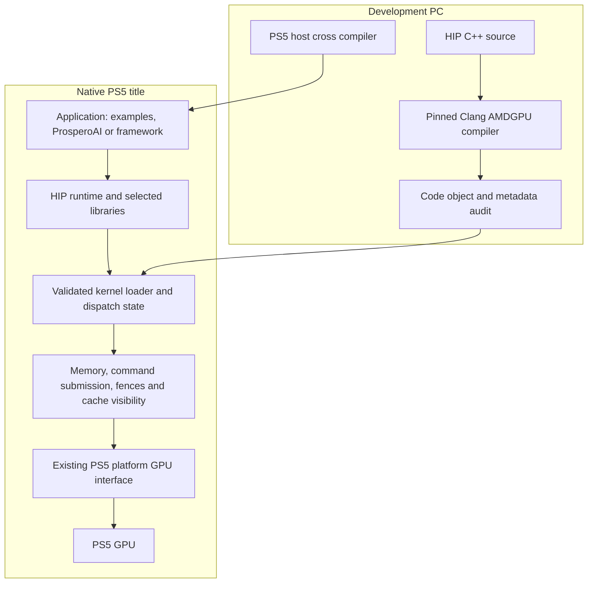

# Native HIP and ROCm capabilities on PlayStation 5

Updated: 2026-10-13, America/New_York.

Status: G1 passed its offline acceptance; G2 passed for the declared arithmetic
fixture in `../evidence/native-g2-acceptance.json`. G3 has one exact private-call
hardware computation observation with delayed completion evidence and one bounded
compiler-spill cycle plus static, dynamic and mixed LDS cycles. Persistent-buffer
visibility has recovered computation evidence with an inconclusive original cycle.
Full/partial wave32 and exact 2D/3D geometry fixtures have passing bounded native
cycles. The fixed relaxed atomic suite also passed six contended 32/64-bit add,
CAS and indirect-add dispatches with 98,694 validated values and clean teardown;
see `../evidence/native-atomic-suite.json`. The numerical math candidate failed its unchanged subnormal-output contract;
offline reproduction identifies an explicit compiler underflow cutoff. See
`../evidence/native-math-current-failure.json`. The isolated compiler correction
passed independent offline review without changing the oracle; see
`../evidence/offline-exp-cutoff-correction.json`. The corrected fixture then passed
all 1,542 values under the unchanged contract on .40, with complete natural
teardown and independent audit; see `../evidence/native-math-exp-corrected.json`.
Broader G3 qualification remains open. G4's fixed genuine HIP vector and
shared four-route clients have passed bounded native cycles with complete
compiler/runtime cleanup; broader client qualification remains open. G5-G12 remain
planned. The four-route title `67072dd` (integrated at `1fb5ada`) completed eight
blocking launches in two changed-input sequences through integer, static LDS,
buffer scratch and 2D geometry. Its 393,216 comparisons cover whole host pages,
including immutable inputs and guards; they are not an active shader output count.
See `../evidence/native-hip-routes.json` and
`../evidence/offline-shared-hip-runtime.json`.
The bounded reusable single-module HIP runtime now also has native client
validation: eleven blocking submissions in sequences 0/1/3/7 through two genuine
registered kernels, exact results and complete cleanup, independently audited.
See `../evidence/native-hip-generic.json` and the offline qualification in
`../evidence/offline-bounded-hip-runtime.json`. The genuine tiled-matmul client
also passed eight native launches across four shapes and two rounds, with 982
exact integer-valued FP32 outputs and complete natural teardown; see
`../evidence/native-hip-matmul.json`. The unedited HIPIFY translation also passed
six native launches, 662 exact wrapping sums and complete teardown; see
`../evidence/native-hipify-client.json`. A main-initialized queue now also passed
five serialized main/A/B/A/main dispatches with two joined workers, 661 exact
values and complete audited teardown; see `../evidence/native-hip-workers-main.json`.
Broader G4 remains open. Frozen native candidates and validation receipts exist. See `../STATE.md`
for the current evidence and next experiment.

## 1. Mission and completion levels

The isolated native ROCclr CPU title is now frozen, packaged and independently
reviewed. Its genuine upstream queue workload, repaired exception lifetimes,
watchdog, native link/conversion and six-file UFS package pass offline checks;
see `../evidence/offline-clr-cpu-native-package.json`. Native startup and shutdown
still require console execution. This CPU-only case does not establish a GPU
backend or public HIP initialization and does not complete G5.
After registered-only deployment, fully instrumented adapter tests exposed shared
upstream thread-state and queue-teardown races. The CPU launch is held: its
termination path has the same missing join evidence. A corrected, independently
qualified thread-lifetime implementation and new candidate are required.

The integrated multi-module/query candidate produced correct A/B/A results and
natural shutdown on .40, but its collector expired before the post-run snapshot.
The original cycle remains inconclusive; see
`../evidence/native-multi-query-incomplete.json`. A separate read-only observation
now establishes unchanged eventual mount state, installed bytes and application
log, with no intervening title lifecycle; see
`../evidence/native-multi-query-delayed-post-state.json`. Original acceptance
remains false, and the consumed GPU workload was not replayed.

The experimental upstream ROCclr port now explicitly rejects unsupported RWX
memory requests before mapping changes. Ordinary memory operations, two CPU
command modes, native object/link checks and exact patch reproduction pass;
see `../evidence/offline-clr-rwx-guard.json`. Native application startup and the
upstream GPU backend remain open; this is not G5 acceptance.

The isolated threaded runtime `30f3c9f` now passes independent offline review,
34 ASan/UBSan modes, 16 CPU-only TSAN modes and five title lifecycle suites.
See `../evidence/offline-threaded-hip-runtime.json`. Its unchanged single-thread
HIPIFY workload subsequently passed on .40 with independent audit of all six
launches and natural teardown (`../evidence/native-threaded-hipify-control.json`).
It is now integrated at `a5b89aa`, with refreshed compiler authorities and 55
configured host tests passing; see `../evidence/offline-threaded-runtime-integration.json`.
The subsequent isolated
`2aa3c530` main-initialized queue passed actual joined-worker calls and independent
audit: 661 active values, 1,355 device-readback and 1,355 host-template comparisons,
17 phase checks and 11 direct AGC events. See `../evidence/native-hip-workers-main.json`.
Worker-side queue initialization subsequently passed its separate native cycle
at `a7e6da7`: prebackend state on A, actual AGC initialization on A, four ordered
A/B/A/main dispatches and complete audited teardown. See
`../evidence/native-hip-workers-init.json`. General simultaneous callers and repeated
initialization still require separate qualification.

The subsequent isolated `70a604a` contention experiment passed its native cycle:
three main/A/B dispatches, 331 exact values, 813 readback and 813 template checks,
two joined workers and complete audited natural teardown. A launch and B push
overlap in API lifetime; B requests the same runtime gate while A owns it.
Kernel-level blocked waiting, performance and GPU overlap remain unproven.
See `../evidence/native-hip-contention.json`; this experiment is not yet integrated.

The isolated `9bb191b` fill/discovery title subsequently passed its native cycle:
discovery before backend initialization, 24 tracked fills, six launches consuming
662 GPU input values, and 746 input plus 746 output whole-buffer comparisons.
Guard, truncation, unaligned patch and changed-round checks passed with complete
audited natural teardown. See `../evidence/native-hip-memory-fill.json`.
The title and APIs are integrated with 62 passing offline CMake tests; see
`../evidence/offline-fill-sdk-integration.json`. Native execution remains bound
to the original frozen candidate. DMA, performance and general cache visibility
are not established by this bounded case.

The isolated `9628fa6` synchronous D2D title passed 24 producer/consumer
launches around 12 copies (1,324 words/5,296 bytes), checking 2,648 GPU outputs
and 5,926 whole-buffer words including 630 guards. Distinct and disjoint
same-allocation ranges, changed rounds and complete natural teardown passed.
See `../evidence/native-hip-device-copy.json`. The runtime and title are integrated
with 64 passing offline tests (`../evidence/offline-device-copy-sdk-integration.json`).
DMA, bandwidth, asynchronous transfer and general cache coherence are unproven.

The isolated `7b41b24` upstream block-reduction title passed three native
dispatches at 16 groups of 1,024 threads and 4,096 bytes of dynamic LDS.
All 48 exact signed outputs, 72 guards, unchanged input/mask readback and
complete natural cleanup passed. See `../evidence/native-hip-reduction.json`.
Combined SDK integration now passes the source-bound offline qualification in
`../evidence/offline-multi-reduction-sdk-integration.json`. Arbitrary reduction
kernels, performance and broader G4 remain open.

Build a native PS5 compute platform that lets developers bring real HIP software
to the console, reuse selected ROCm libraries, and execute useful inference and
training workloads. Make the runtime reusable beyond ProsperoAI and understandable
enough that another developer can reproduce it without the original workstation.

The most ambitious core demonstration is **native PyTorch on PS5 performing a
forward pass, backward pass, optimizer update and checkpoint/resume, followed by
a useful bounded fine-tuning experiment**. The inference milestone is an actual
ProsperoAI HIP backend with model parity and measured tradeoffs against Vulkan.
The platform milestone is a versioned SDK, reliable resource ownership, declared
capabilities and reproducible evidence.

These are engineering objectives, not predictions that every dependency will
port unchanged. Hardware constraints are research questions with explicit
alternatives. When a preferred implementation fails, preserve the objective and
change the implementation based on evidence.

| Completion level | Observable outcome | Goals |
| --- | --- | --- |
| Native execution proof | Qualified HIP-compiled code executes with correct launch and compute semantics | G1-G3 |
| Usable HIP development preview | Real HIP C++ programs, streams/events and graph replay work within documented limits | G4-G5 |
| Application SDK | Useful libraries and a ProsperoAI integration build from pinned dependencies | G6-G7 |
| Ambitious core platform | Native framework inference and training, measured performance and sustained reliability | G8-G10 |
| Frontier research | Native compilation/graph compilation and multi-console compute experiments | G11-G12 |

A canary closes a canary gate. It does not close the application SDK or platform
objective. Conversely, a working subset remains valuable even if a later frontier
goal is infeasible; report its precise boundary instead of claiming full ROCm.

## 2. Baseline and project requirements

The [research baseline](RESEARCH_BASELINE.md) records the initial source revisions.
The current ProsperoAI reference is its shared Prism llama/ggml Vulkan runtime,
not the older architecture-specific AGC inference path. Its existing GPU capability
is our control. We are seeking broader software reuse and measurable improvements
on that baseline.

### Functional requirements

- **R1: Compilation.** Compile real HIP device code with a pinned AMDGPU toolchain;
  build host application code for the PS5 ABI rather than copying Linux binaries.
- **R2: Kernel execution.** Load qualified code objects, honor their entry contract,
  execute kernels and return validated results through native PS5 submission.
- **R3: Compute semantics.** Implement declared memory, workgroup, wave, atomic,
  private-storage and floating-point behavior correctly.
- **R4: HIP application API.** Support the runtime features real selected clients use,
  including correct errors for unsupported functions and features.
- **R5: Libraries.** Run useful BLAS and other selected library entrypoints with
  validated kernels and appropriate fallbacks.
- **R6: Inference.** Integrate with ggml/ProsperoAI without losing its model-format,
  tokenizer, numerical or session behavior.
- **R7: Frameworks.** Run native framework inference and autograd/optimizer workloads.
- **R8: Developer experience.** Supply a reproducible SDK, examples, capability query,
  diagnostics and enough evidence for another developer to reproduce results.

### Non-functional requirements

- **N1: Truthful compatibility.** Distinguish source, device-binary, host-binary and
  framework support. A capability is false until its acceptance test passes.
- **N2: Bounded failures.** Validate code and allocations before submission; retain
  referenced memory until completion; avoid unbounded waits and silent success.
- **N3: Reproducibility.** Pin sources, tools and generated kernels. Keep candidate
  hashes, exact commands and compact evidence with each accepted milestone.
- **N4: Honest measurements.** Compare the same workload, context, cache state and
  numerical contract. Count CPU fallback, memory and teardown costs.
- **N5: Isolation.** Separate this SDK, ProsperoAI integration and graphics-driver
  changes. Existing working installations and user data are preserved.
- **N6: Maintainability.** Reuse existing public components; make narrow upstreamable
  patches. Add abstractions only when they serve an implemented client.

### Physical and platform limits

This plan targets the base PS5 homebrew environment first. PS5 Pro, other firmware
and simultaneous workloads require separate qualification. Shared physical memory
does not imply automatic cache coherence, unlimited allocations or support for
managed-memory page faults. The available application budget must be queried and
measured on the actual target.

Do not assume modern MFMA/WMMA acceleration, working accelerated dot products,
XNACK/page-fault migration, user-mapped AQL queues, independent compute queues,
system-scope atomics or GPU reset capability. No initial milestone requires them.
Where a feature is fundamental to a client, either implement and prove it, choose
an equivalent valid algorithm, or report the client unsupported.

## 3. Proposed architecture

### 3.1 Three boundaries to keep explicit

**Compiler boundary.** Separate device compilation, device linking and native host
compilation. Start with ahead-of-time device code. Record compiler target, features,
wave mode, floating-point settings, code-object version and resource requirements.
Compare `gfx1013` with a restricted GFX10.3 candidate, then freeze the measured
configuration. Do not select `gfx1030` because its name appears in ROCm builds.

**Execution boundary.** Native submission consumes a validated launch description,
not arbitrary desktop queue state. Translate the qualified kernel descriptor into
PS5 execution state, build the required argument storage and keep all code/data
resident through completion. The first implementation may use one physical queue.
It need not expose raw AQL queues to applications or replace the console kernel.

**Application boundary.** Public API behavior is defined by the selected HIP
version and the documented subset. Device properties and availability queries must
reflect this implementation. Never equate a successful symbol resolution with a
working operation or silently change an operation's numerical contract.

### 3.2 Runtime implementation decision

G2-G3 should establish a small launch substrate with no framework dependency.
Before expanding G4 beyond a narrow subset, compare these approaches using actual
client requirements and a build spike:

| Approach | Reason to consider it | Main cost or risk |
| --- | --- | --- |
| Small HIP compatibility runtime over the native substrate | Fastest way to exercise a bounded client and keep dependencies visible | API/semantic maintenance grows quickly with framework coverage |
| A PS5 backend beneath upstream HIP/CLR | Reuses upstream API behavior, host registration and client integration | Native host dependencies and the breadth of the device interface |
| A ROCr/HSA adaptation above native submission | Could reuse more HSA-facing code and ecosystem behavior | Queues, signals, memory model and firmware assumptions require deep validation |

Choose one main runtime architecture at G4. Maintain only a small launch harness
as an independent diagnostic control. Do not build three production runtimes.
If the narrow runtime starts reimplementing substantial upstream scheduling and
memory management, reassess the CLR route before accumulating incompatible APIs.

The [bounded ROCm6.2.4 comparison](RUNTIME_ARCHITECTURE.md) selects one small
native HIP compatibility runtime for the first serialized examples. Five unchanged
CLR units compiled on Linux in that initial comparison. The subsequent
[upstream platform checkpoint](../evidence/offline-upstream-clr-platform.json)
rebuilds 27 upstream units plus a pthread TLS helper and exercises actual
two-queue memory/kernel commands on a synthetic CPU backend, including failures
and retirement. PS5 OS and explicit graphics-rejection adaptations now compile;
selected BSD API calls link against the SDK. The subsequent
[experimental port](../evidence/offline-upstream-clr-native-port.json) compiles
all 27 upstream units plus TLS and links both the internal runtime and a CPU
command workload with the native SDK. `ports/clr` preserves the exact patch.
Application startup, six weak SDK hooks, native OS behavior, public HIP
initialization and a real GPU backend remain unqualified.
The early configure failures identified missing local COMGR dependencies, not
platform impossibility.
Reassess CLR before general asynchronous scheduling, cross-stream event dependencies,
callback workers, deferred shared pools, graph capture or VMM. This decision does
not qualify G2/G3, HIP API behavior, device libraries or the ggml client.

An HSA adaptation may translate bounded dispatch/signal operations into native
commands. It must not claim hardware AQL support unless that support is proved.
Using Vulkan as a translation fallback is a distinct architecture with different
pointer and kernel constraints, not a transparent way to load arbitrary `.hsaco`.

### 3.3 Memory and command ownership

- Keep allocation metadata on the host: base address, size, alignment, access
  class, lifetime, last writer and outstanding uses.
- Preserve stable virtual addresses while any kernel argument, graph or descriptor
  references an allocation. Distinguish logical free from physical retirement.
- Begin with explicit device allocations and explicit host transfer/visibility
  points. Device pointers are not assumed to make arbitrary CPU allocations usable.
- Use required native cache operations at ownership transitions. A completed fence
  alone is not proof of CPU-visible output.
- Batch related kernels and copies while preserving dependencies; do not insert a
  host wait or whole-model cache flush between every operation.
- Implement logical stream ordering even when streams share one hardware queue.
  Physical overlap is an optimization and must be advertised accurately.
- Expose unsupported managed memory, peer access, cooperative launch or interop as
  unsupported. Add them only when a real client and hardware evidence justify them.

## 4. Goal map

| Goal | Outcome | Dependencies | Status |
| --- | --- | --- | --- |
| G1 | Reproducible compiler and platform contract | None | passed offline |
| G2 | Native execution of a real HIP code object | G1 | passed for named wave32 1D store/vector fixture; two clean cycles of the same frozen image |
| G3 | Correct general compute semantics | G2 | private304 and persistent-buffer computation recovered; spill, static/dynamic/mixed LDS, full/partial wave32 and measured2D/3D cycles passed; broader qualification pending |
| G4 | Real HIP C++ source compatibility | G3 | fixed vector and shared four-route genuine HIP clients passed bounded native cycles; broader qualification pending |
| G5 | Streams, events, graphs and efficient memory reuse | G4 | planned |
| G6 | Useful ROCm math and primitive libraries | G4; G5 for efficient execution | planned |
| G7 | ProsperoAI HIP integration and SDK preview | G5-G6 | planned |
| G8 | Native LibTorch and Python/PyTorch inference | G5-G6 | planned |
| G9 | Autograd, training and bounded LoRA | G8 | planned |
| G10 | Competitive performance and sustained reliability | G7-G9 | planned |
| G11 | On-console HIP compilation and graph compiler experiments | G8-G10 | planned |
| G12 | Multi-console cooperative compute | G9-G10; multiple authorized consoles | planned |

G1-G3 are the critical uncertainty-reduction path. G6 can begin with one operation
before every G5 optimization is complete. G7 and G8 share the qualified SDK and
need not wait on each other's application work. Implementation order follows
dependencies; it does not imply a promise to run concurrent hardware tests.

## 5. G1 — Freeze the compiler and platform contract

**Objective:** establish reproducible inputs and a precise account of what the
native platform can launch. Advances R1, N1 and N3.

Implementation:

1. Inventory public PS5 SDK, packaging, platform submission, memory and completion
   interfaces. Trace the pinned Mesa path down to its native boundary. Identify
   which pieces can be consumed as libraries and which would need small extraction
   patches in their owning repositories.
2. Inspect source provenance before reuse. Record dependency URLs, revisions,
   licenses, build patches, host tools and expected outputs in a lock manifest.
   Research pins are inputs to this selection, not an already tested lock.
3. Compare a compact standalone LLVM/HIP build with the corresponding TheRock
   component build. Select one working, compatible toolchain and code-object
   version; do not build every ROCm library to obtain a compiler.
4. Compile device-only canaries for indexed stores, vector addition and a small
   reduction. Inspect ELF metadata, entry state, instructions, wave mode, SGPR/VGPR
   use, LDS and private storage. Keep the initial kernel free of scratch, device
   calls, printf, dynamic allocation and special matrix instructions.
5. Write a capability contract with observed, hypothesized and untested columns.
   Include an explicit list of instructions and metadata that the first loader
   accepts. A disassembler alone is not a complete safety or compatibility verifier.
6. Select a dedicated development title and record the current hardware environment
   locally before any future run. Establish its authorization and coordination
   protocol rather than inheriting another project's stale settings.

Deliverables: pinned compiler recipe, device-only canaries, metadata inventory,
platform boundary notes and a first capability matrix.

Acceptance: a clean host can reproduce the canaries; every requested initial
execution-state field has an identified implementation or a named blocker; the
audited outputs contain no known unsupported feature. This is an offline gate and
does not establish GPU execution. Normalize recorded nondeterministic metadata or
explain it rather than falsely requiring every compiler artifact to be byte-identical.

Decision: choose the first target/configuration for G2. If no candidate can avoid
an unsupported assumption, reduce the kernel or implement a focused compiler fix.

## 6. G2 — Execute a HIP-compiled kernel natively

**Objective:** bridge AMDGPU code objects to PS5 dispatch. Advances R2 and N2.

Implementation:

1. Implement a bounded ELF/code-object reader. Validate magic, class, target,
   version, file ranges, arithmetic overflow, segment alignment, metadata sizes,
   symbol references and permitted relocations before allocating GPU resources.
2. Load code, constants and supported globals into appropriately aligned native
   allocations. Start with a clearly declared relocation subset; reject unknown
   cases. Do not copy a Linux shared library into console memory and call it loaded.
3. Interpret the kernel descriptor: entry offset, argument size/alignment, fixed
   group/private memory, resource registers, wave mode and required user/system
   registers. Construct required dispatch/implicit-argument records when the
   compiler requests them. Reject fields without a validated implementation.
4. Build argument storage for scalar values and native GPU-visible pointers.
   Establish workgroup/work-item IDs, grid/block dimensions and floating-point
   execution mode. Explicitly qualify global pointer loads/stores; descriptor-based
   Mesa buffer access is not proof of HIP pointer semantics.
5. Reuse the established native submission/completion path. Freeze one application
   candidate and run exact indexed-write then vector-add checks with guards around
   allocations. Distinguish submission, execution, readback and clean teardown.
6. Exercise odd lengths, tail guards, multiple workgroups, multiple dispatches and
   supported dimensional launches. Unsupported launch dimensions must fail before
   execution, not be silently flattened incorrectly.

Acceptance: exact expected output and untouched guard regions across the declared
launch set; repeated clean launch/close cycles; all required entry state accounted
for; unsupported objects rejected on the host. Record raw output and hashes.

Decision: proceed to G3 only after genuine device-code execution is proven. If
entry-state programming is inaccessible, isolate the missing field and investigate
an equivalent compiler lowering or public platform path. A hand-written replacement
kernel can diagnose the launch path but cannot satisfy the HIP code-object gate.

## 7. G3 — Prove compute semantics beyond a canary

**Objective:** establish a trustworthy compiler/runtime contract. Advances R3.

Qualification is incremental and uses a CPU or existing validated GPU oracle:

| Feature family | Required cases |
| --- | --- |
| Addressing | 64-bit pointer arithmetic; aligned/unaligned accesses where legal; offsets into large allocations; separate buffers |
| Workgroups | 1D/2D/3D index calculations, multiple waves, legal partial-grid tails and dynamic LDS |
| Synchronization | LDS exchange with barriers; dependent dispatches; device-memory visibility between kernels |
| Wave operations | Broadcast, shuffle, ballot and reductions for each advertised wave mode; inactive-lane cases |
| Atomics | Contended add/CAS and supported widths/types; memory order/scope combinations actually advertised |
| Arithmetic | Integer boundaries, FP32 and FP16 conversion/arithmetic, selected transcendental device functions |
| Numerical modes | FMA behavior, NaNs, infinities, signed zero, subnormals and rounding where the API promises them |
| Private storage | Forced spills, address-taken locals, indexed private arrays and nested device calls |
| Linking | Supported device globals, constants, relocations and separately compiled device functions |
| Visibility | Host-written input, GPU-written output and alternating ownership across repeated dispatches |

Private storage is a first-class gate. Force enough live values to trigger real
compiler spilling and inspect the emitted code; a test optimized entirely into
registers does not qualify scratch. Investigate buffer-backed scratch or appropriate
compiler lowering when the flat-scratch path is invalid. Separately qualify generic
pointers to global, local and private storage before advertising generic-address
behavior. Never silently alias per-thread storage.

Start with conservative math. Later relaxed modes require separate numerical and
model checks. Exact integer results and race-free synchronization are mandatory;
floating-point tolerances must come from the operation and accumulation contract,
not be widened after observing a failure.

Acceptance: every advertised capability has a positive test, relevant boundary
cases and an explicit unsupported/error case where applicable. Compile at more
than one optimization level to catch accidental dependence on code shape. Required
G4 client kernels must fit the qualified feature set. Forced spilling and LDS
barriers cannot be deferred while calling this a general compute milestone.

Decision: lock the feature profile and compiler settings. Record platform-specific
workarounds as narrow changes with reproductions. Do not generalize a working
instruction subset into complete `gfx1013` or `gfx1030` compatibility.

## 8. G4 — Make real HIP C++ programs work

**Objective:** deliver source-level usability. Advances R4 and R8.

Before expanding the API, inventory actual symbol and semantic requirements from
small upstream HIP examples and the intended ggml HIP client. Use that evidence to
choose the runtime architecture from section 3.2 and document the decision.
The pinned source inventory is in [HIP client requirements](HIP_CLIENT_REQUIREMENTS.md);
it records the example slice, broader ggml contract and architecture-dependent
instruction selection that still needs qualification.
The [host ABI spike](HIP_HOST_ABI_SPIKE.md) now identifies real registration
symbols, fat-binary layout and a compatible full-header fixture using ROCm 6.2.4.
Its vector kernel requires 288-byte kernarg storage with runtime-generated hidden
geometry fields. Checked explicit/hidden separation and uniform 64x1x1 packing
now pass host tests; the native fixtures remain unrun. Preserve the PS5 host ABI
while routing device ABI flags separately. The complete device-library build
remains unresolved; the successful workitem-only fixture is not a library port.

The [single-TU registration control](HIP_HOST_REGISTRATION_CONTROL.md) now consumes
one actual combined object through its genuine compiler constructors and launch
stub, with linker-bounded wrapper/bundle spans and owned module/token bindings.
Linux normal and partial-failure teardown pass; PS5 linking and conversion preserve
the checked extents and relocations. Dispatch explicitly returns unsupported.
This is offline preparation, not working native HIP launch syntax or G4 acceptance.

The separate [owned native data and memory ABI control](NATIVE_DATA_REGISTRY.md)
now checks real allocation owners, logical copy extents, free, GPU-use refusal and
terminal poison against pinned full HIP headers. Host models and PS5 linking pass.
The subsequent [connected vector control](HIP_NATIVE_VECTOR_CONTROL.md) now routes
the genuine compiler launch through native allocation, argument preparation and
blocking submission, with actual compiler unregister. Its 26 host scenarios and
48 integrated checks pass; native compilation/linking is verified. These checks
do not execute AMD instructions. The follow-up [native HIP title](HIP_NATIVE_VECTOR_TITLE.md)
adds Eden and checked shell-managed finalization;22 lifecycle cases and50 integrated
sanitizer checks pass, and its frozen image passed filesystem/extraction validation.
Actual unregister and complete runtime destruction precede shell exit. The fixed
vector title subsequently passed its bounded native cycle. The shared four-route
title additionally passed 71 integrated checks, 29 lifecycle models, 19 ordinary
route models, preserved vector coverage and a native cycle on .40. Eight blocking
launches across two changed-input sequences passed all whole-page input, output
and guard comparisons; actual compiler unregister and State destruction preceded
natural process teardown. See `../evidence/native-hip-routes.json`. These measured
single-TU clients do not qualify arbitrary programs, asynchronous streams or G4
as a whole.

The [argument capture control](HIP_HOST_LAUNCH_CAPTURE.md) additionally copies the
real stub's argument values into owned storage, resolves synthetic live-data
extents and calls the existing hidden-geometry planner/packet encoder. All34
integrated sanitizer checks pass. Dispatch still returns unsupported; no native
mapping, allocation lifetime, submission or normal-launch hardware claim follows.

Implement the first coherent API slice:

- Initialization, device count/selection, honest device properties and errors.
- Explicit allocation/free, memset, supported copy directions and pointer queries.
- Module load/unload, function lookup and launch; supported device-global lookup.
- Synchronization and the simplest stream/event behavior required by the clients.
- Native host registration of compiled kernels/fat binaries where the selected HIP
  frontend requires it, so normal launch syntax is supported without editing kernel
  bodies into an application-specific descriptor language.

The module API is a useful intermediate step, not a substitute for normal HIP
C++ source compatibility. Specify which runtime registration ABI and compiler
version are accepted. Host code is cross-compiled against PS5-compatible headers,
libraries and imports. Build-time code generation stays on the development PC.

Error handling must distinguish malformed input, unsupported features, allocation
failure and device loss. Failed initialization and partially loaded modules must
unwind completely. A free/unload while work is in flight must honor the selected
HIP contract and cannot release live backing storage.

Acceptance: several upstream-style HIP examples, including vector addition,
reduction and tiled matrix multiplication, compile with normal kernel launch syntax
and run correctly. A small ordinary CUDA example translated with HIPIFY also runs;
record every additional source/build change. This proves that example, not general
CUDA binary compatibility. Multithreaded host calls and repeated initialization,
allocation failures and shutdown pass bounded tests.

The CPU prerequisite has passed on firmware 12.70: two joined workers, 256
ordered updates, isolated scalar emulated TLS, key destructors and clean
synchronization teardown. See `../evidence/native-host-threads.json`. Checked
per-thread launch/error state and shared ownership subsequently passed isolated
offline qualification; main-initialized joined-worker HIP calls then passed the
finite native case in `../evidence/native-hip-workers-main.json`. This does not
complete multithreaded HIP acceptance. Worker-side initialization has separately
passed `../evidence/native-hip-workers-init.json`; the bounded overlapping API
case in `../evidence/native-hip-contention.json` has also passed, with kernel-level
blocked waiting and general concurrency still unqualified. The combined HIPIFY
title/build integration is separately
qualified in `../evidence/offline-hipify-title-integration.json`.

Decision: publish the supported API matrix internally. Missing required semantics
block the client; do not fill exported symbols with success-returning stubs.

## 9. G5 — Streams, graphs and memory efficiency

**Objective:** keep GPU workloads resident and avoid paying a host round trip for
every operation. Advances R4, N2 and N4.

Implement ordered logical streams, event dependencies, asynchronous copies where
supported, query/wait behavior and timestamps. Write down default-stream semantics
for the chosen HIP version. One physical queue may serialize logical streams
correctly; never report concurrent execution without measuring it.

Then add graph construction/capture and replay for the node types required by the
selected inference client. Define capture invalidation, graph ownership, parameter
updates, allocation lifetime and error propagation. Replaying a graph must not use
freed arguments, reset mutable model state or omit inter-stream dependencies.

Add allocation pooling and deferred retirement where measurement justifies them.
Graph and event references must participate in retirement. Start with ordinary
allocations; virtual-memory reservation/remapping and asynchronous allocation APIs
are separate features, not aliases to functions with different semantics.

Profile CPU preparation, submit time, GPU elapsed time, waits and cache operations.
For small kernels, report timing resolution and instrumentation overhead. A reusable
dispatch graph is the first optimization target; kernel fusion follows measured
occupancy and correctness, not the assumption that fewer kernels always win.

Acceptance: eager and captured execution agree over changing inputs; cross-stream
producer/consumer tests pass; graph update and destruction are correct; repeated
replay reaches a stable memory plateau. A warm multi-kernel replay uses bounded
submission counts and demonstrates a measured reduction in host overhead against
the unbatched control. Total application latency remains separately measured.

Decision: keep a single physical queue unless a qualified second queue offers a
measured benefit that outweighs its synchronization and recovery complexity.

## 10. G6 — Bring up useful ROCm libraries

**Objective:** make reusable mathematical building blocks available. Advances R5.

Port libraries in order of application value and dependency cost:

1. **Device math and primitives.** Required OCML/OCKL or equivalent toolchain device
   libraries, selected rocPRIM/hipCUB reductions, scans and sorting operations.
2. **BLAS.** FP32 GEMM, FP16 inputs with the required accumulation precision, GEMV,
   transposed/strided and batched operations. Use hipBLAS/rocBLAS where practical.
3. **Random generation and FFT.** Add rocRAND/hipRAND and rocFFT/hipFFT subsets when
   a selected model or training operation requires them.
4. **Convolution and training operators.** Investigate MIOpen or another explicit
   HIP implementation for forward/backward convolution, normalization and activation.
   hipDNN dispatch is useful only when a working provider exists.

Build only the required architecture kernels. Inspect generated Tensile code and
the selected solution database rather than assuming compilation means coverage.
Record dispatch selection so an unexpected fallback cannot masquerade as a tuned
kernel. Qualify strided layouts, leading dimensions, transpose combinations,
non-square shapes, tail tiles, alpha/beta and workspace requirements.

For gfx10-class hardware, use valid vector/packed arithmetic and LDS tiling as
appropriate. Do not depend on rocWMMA, hipBLASLt, Composable Kernel or hipTensor
merely because they belong to ROCm. The initial upstream target exclusions and
PS5-specific feature limitations must shape algorithm selection.

If a full library cannot yet be ported, a documented operation implementation can
advance a client. Call it a supported operation subset; do not label a handful of
entrypoints a complete rocBLAS or MIOpen port. Preserve the full library objective
where it has practical value and record what blocks expansion.

Acceptance: supported entrypoints match a CPU reference over representative small,
large and irregular shapes with declared tolerances. Run the relevant upstream
test subset and report its inventory and skipped cases. At least one real client
uses a supported library operation. Report workspace, peak memory, CPU fallback,
initialization and steady-state times. Performance work cannot waive numerical
or error-path correctness.

Decision: retain libraries that reduce application work or provide useful kernels.
Avoid carrying an enormous tuned-kernel database that the console cannot use.

## 11. G7 — Integrate ProsperoAI and deliver an SDK preview

**Objective:** prove that the platform is useful in the existing application.
Advances R6 and R8. Integration changes belong on a ProsperoAI development branch.

Start by building a standalone ggml/llama HIP client against ps5-hip. Inventory
the API and kernels it actually uses. Then connect the same implementation to
ProsperoAI's pinned Prism ggml ABI. Quantized formats, including its ternary Bonsai
path, require actual kernel support; a working dense GEMM does not provide them.

Qualification ladder:

1. One small dense model with deterministic token/logit comparison and CPU fallback
   accounting, followed by a representative quantized model.
2. Current Mistral and Qwen paths, prefill/decode separation, multi-turn KV reuse,
   context changes and model switching. Measure memory use after every transition.
3. Exact supported Prism/Bonsai format coverage, including its tokenizer and current
   generation modes. Do not silently dequantize the entire model to exceed the
   available memory budget or change the model being compared.
4. SD-Turbo, Stable Audio and Kokoro through the shared application runtime where
   supported. Attribute remaining CPU operators, allocations and uploads explicitly.
5. Application lifecycle: cancellation, out-of-memory behavior, loading failure,
   repeat requests, return to text after media, session preservation and clean exit.

Keep Vulkan selectable and default during qualification. Inference routing belongs
to ProsperoAI; ps5-hip supplies the compute dependency and its capability report.
Separate functional fallback from a benchmark: a supposedly GPU result must disclose
all CPU work and any operations routed through another backend.

Acceptance: a frozen native application candidate passes representative text and
media fixtures using a pinned ps5-hip SDK, with supported model coverage stated
precisely. Text checks include logits/tolerance and deterministic token fixtures;
where floating-point differences alter argmax, investigate and evaluate quality
rather than hiding the mismatch or assuming all text must be bit-identical.
Media checks use fixed seeds, numerical comparisons, valid artifacts and inspection.
No loss of saved sessions, legacy model aliases or normal launcher behavior.

The SDK preview includes headers/library artifacts, versioned capability metadata,
compiler requirements, a minimal application template and instructions reproducible
from a clean host. Repository privacy and release publication remain owner decisions.

Decision: a preview can be valuable for new capability even without a speed win.
Changing ProsperoAI's default requires the corresponding correctness, stability and
benefit gates; it is not an automatic consequence of reaching G7.

## 12. G8 — Native LibTorch and Python/PyTorch inference

**Objective:** make the console a framework target rather than only a custom
inference appliance. Advances R7 and is a major expansion in host-platform scope.

Take two explicit steps:

**G8a: Native C++ framework runtime.** Cross-build the relevant ATen/LibTorch and
HIP dependencies. Produce an operator inventory from selected inference graphs.
Resolve threading, atomics, exceptions, dynamic loading, filesystem, timers and
native C/C++ runtime requirements with existing public PS5 components where
possible. Disable unrelated backends and distributed features initially. Run the
GPU operator set first, then an actual model forward pass.

**G8b: Python frontend.** Qualify a compatible native CPython runtime and extension
module ABI. Package a source-built PyTorch subset for that environment. A build
running on WSL, a CPU-only tensor, or a Python process delegating inference to a PC
does not satisfy this stage. Verify that framework tensor operations allocate and
execute through ps5-hip on the console.

Begin with tensor construction, arithmetic, matrix multiplication, reductions,
indexing, activations, normalization and necessary convolution/attention paths.
Add an explicit coverage report for decomposed or CPU-fallback operations. Preserve
dtype, stride, broadcasting and aliasing semantics; many framework errors come from
these contracts rather than the arithmetic kernel itself.

Use small models with locally prepared inputs and reference outputs. Increase
complexity only after the operator path is known. Initially avoid runtime codegen
and exotic fused kernels; G11 addresses compilation later. This is a deployment
choice, not a claim that eager inference covers all PyTorch models.

Acceptance: a native C++ model forward pass and a native Python script use the PS5
GPU, return reference-checked outputs and release resources correctly. Tensor
views/non-contiguous layouts and error cases pass the declared subset. Record
unsupported modules and operators, source/build patches, executable imports,
startup time and peak memory.

Decision: if Python integration is blocked, retain G8a as a partial milestone and
state the remaining ABI/dependency blocker. Do not rename C++ inference as a
completed Python/PyTorch port.

## 13. G9 — Autograd, small-model training and LoRA

**Objective:** show that useful learning workloads can execute on the console.
Advances R7 beyond inference. This is the ambitious core demonstration.

First implement or port the necessary backward kernels and optimizer operations.
Validate individual gradients with finite differences on small problems and compare
forward/backward outputs with a pinned CPU or established GPU reference. Check
accumulation dtype, loss scaling where used, overflow detection, deterministic
randomness and zeroing/accumulation of gradients.

Proceed through three training milestones:

1. **Deterministic learning canary.** A small MLP or convolutional network trains on
   a synthetic task. Loss decreases, gradients are finite, weights change and
   saved/reloaded checkpoints continue the same declared training sequence.
2. **Small transformer.** Target a roughly 10-50 million parameter model and at
   least 500 optimizer steps with a recorded dataset split. Measure training tokens
   per second, wall time, memory, validation loss and repeated-seed behavior. This
   size/step target is an experiment proposal and may be refined before execution
   when memory and runtime measurements are available.
3. **Bounded LoRA fine-tuning.** Start with a 0.5-1.5B model, then investigate 3B if
   memory permits. Account separately for base weights, adapters, activations,
   gradients, optimizer state and temporary workspaces. Use accumulation and
   checkpointing deliberately. A QLoRA path requires its actual quantization and
   backward support; inference quantization alone does not supply it.

For each experiment, freeze the model, input data, initialization, optimizer,
schedule, loss definition and evaluation method before comparison. Use an owned
or appropriately licensed dataset and keep weights and datasets out of Git.

Acceptance: forward/backward/optimizer parity within justified tolerances; a
checkpoint/resume oracle; finite, meaningful training progress; stable allocations;
and a held-out result for the LoRA experiment that demonstrates the intended
adaptation without evaluating solely on the training examples. Preserve negative
results if optimization fails to improve the target task. Changing output alone
is not evidence of successful fine-tuning.

Decision: scale only while measured memory and stability allow. A useful small
training capability is a substantive achievement; do not promise large-model full
training or derive training capacity from quantized inference fit.

## 14. G10 — Make performance and reliability competitive

**Objective:** turn a working port into a credible compute platform. Advances
N2-N4 and determines which applications should adopt it.

Optimize measured dominant costs in this order unless evidence indicates another:

1. CPU launch/registration overhead, graph reuse and unnecessary synchronization.
2. Repeated transfers, broad cache operations, allocator churn and workspace reuse.
3. Memory access patterns, quantization/dequantization and effective bandwidth.
4. GEMM/attention tiling, occupancy, register pressure, scratch traffic and LDS reuse.
5. Operator fusion, batch scheduling and framework decomposition.

Before a change, estimate its maximum whole-workload benefit from measured time.
Keep CPU and GPU times separate; overlapping counters are not additive. Compare
against the current qualified Vulkan revision, not an obsolete slow baseline.

Initial performance aspirations, explicitly **not acceptance claims**:

- Match representative Vulkan decode within 10% while delivering HIP compatibility.
- Find at least one useful prefill, media or library workload with a repeatable
  improvement of 20% or more, or a material memory/capability advantage.
- Reduce warm multi-kernel launch overhead by at least 2x versus the first correct
  unbatched ps5-hip implementation, without increasing total application latency.
- Keep runtime/allocator growth bounded and explain the peak-memory difference
  against the control. Do not assume HIP will use less memory.

These goals guide experiments. They are neither forecasts nor reasons to hide
small wins, regressions or workloads on which Vulkan remains preferable.

Reliability qualification progresses from short cases to a 30-minute mixed workload,
then an authorized two-hour soak only after shorter gates pass. Include repeated
initialization, allocation pressure, graph/module destruction, text/media switches,
training checkpoints and cancellation. Use guard allocations and leak accounting.
Measure available memory at equivalent idle points and distinguish caches from
unrecoverable growth. Fault-injection tests begin on the host; GPU hangs or invalid
instructions are not routine automated stress inputs.

Acceptance: repeated matched benchmark results with uncertainty and limitations;
no unexplained numerical regression; no accumulating allocation growth; successful
bounded teardown and healthy services after each accepted run. Publish a per-model
recommendation and a per-firmware capability matrix. A second firmware can be
qualified only using recorded candidate bytes and the same appropriate tests.

Decision: recommend HIP as a default only for the workloads where the measured
tradeoff warrants it. Keep compiler and driver changes independently reproducible
and upstream suitable corrections with minimal reproductions when publication is
authorized.

## 15. G11 — Native compilation and graph compiler experiments

**Objective:** remove more of the development-PC dependency and explore modern
framework compilation. This is frontier work after the core platform is useful.

First port the minimum compiler/runtime components needed for HIPRTC or an
equivalent native compilation service. Account for executable loading, temporary
storage, device-library linking, compiler memory, cancellation and diagnostics.
Cache generated code by source, compiler version, target features, options and
runtime ABI. Invalidate the cache when any contract changes.

Acceptance for native compilation: the console compiles a new supplied HIP source
kernel, runs it, validates its result and reuses its cached artifact in a subsequent
run. Host compilation with console-side execution remains the earlier G1-G10 path
and must not be relabeled as native compilation.

Then investigate `torch.compile`/TorchInductor or Triton-generated kernels against
the validated hardware feature set. Begin with pointwise/reduction fusion and
SIMT matrix kernels. Inspect generated code for assumptions about matrix units,
warp/wave behavior, scratch and synchronization. A successful Triton import does
not establish a usable PS5 compiler backend. If gfx10 support is impractical, use
the supported framework decomposition or a custom HIP code-generation path and
name that architecture honestly.

Acceptance for graph compilation: eager and compiled model/operator paths meet
the same numerical contract; compilation and warm-cache costs are separately
reported; at least one actual graph has a repeatable end-to-end benefit. Preserve
an eager fallback and meaningful compiler-error reporting.

Decision: retain this work only if it improves developer autonomy or workloads
enough to justify toolchain size and maintenance. No whole-console LLVM deployment
is needed to call the earlier application SDK successful.

## 16. G12 — Multi-console cooperative compute

**Objective:** investigate a small owner-controlled PS5 compute cluster. This is
a separate frontier extension, requiring multiple available authorized consoles.

Start with independent inference jobs and batched experiment scheduling through
an explicit application protocol. Then attempt data-parallel small-model training
with gradient exchange over the LAN. Use a host coordinator if useful, but state
where computation and data reside. Do not claim that network messages implement
HIP peer memory, GPU-to-GPU RDMA or transparent cross-console pointers.

Measure serialization, network transfer, synchronization and straggler time before
attempting a collective library. An initial CPU-staged all-reduce can be useful,
but is not a native RCCL port. Tensor/pipeline parallel large-model inference is a
later experiment only if layer compute can amortize communication. Extra consoles
do not create a single transparent GPU memory pool.

Acceptance: two consoles execute assigned work correctly; a distributed training
step agrees with the single-device reference at the same effective batch size;
checkpointing, participant loss, retry and cancellation have defined outcomes;
scaling efficiency is measured rather than inferred from device count.

Decision: stop scaling when communication dominates or availability makes evidence
unreliable. Retain useful distributed batch inference even if tightly coupled
training is a poor fit for the available network.

## 17. Initial API and capability policy

The exact API inventory is produced from the selected client and HIP header pin.
This table sets priorities, not an assertion that these functions exist today.

| Area | Initial direction | Expansion gate |
| --- | --- | --- |
| Device discovery and errors | One real device; accurate properties and error state | Additional device types only after qualification |
| Explicit memory | Allocation/free, memset, supported copies, pointer metadata | Stream-ordered allocation after lifetime tests |
| Module API | Qualified object load/unload, function/global lookup and launch | New object versions/relocations need fixtures and hardware checks |
| Normal HIP launches | Host registration/fatbinary support for the pinned compiler | Device linking and additional frontend versions qualified separately |
| Streams/events | Correct ordering, waits, queries and supported timing | Physical overlap only after measured native support |
| Graphs | Required kernel/copy/event nodes and replay | Capture/update/node types added for real clients |
| Device math | Explicit required functions and dtype contracts | New modes need numerical tests |
| Managed memory and virtual memory | Unsupported initially; capability queries reflect that | Mapping/migration semantics must be implemented, not approximated silently |
| Cooperative launch and device enqueue | Unsupported initially | Requires progress and occupancy guarantees |
| IPC and external graphics interop | Unsupported initially | Ownership and synchronization validated across participants |
| Multi-device/peer access | One native GPU; no peer-pointer claim | G12 uses a distinct network protocol |
| Debug/profiling APIs | Host timings, native fences and available timestamps | Counters/traps/debugging need their own platform implementation |

Return the version-appropriate unsupported error. Do not fabricate a successful
allocation, available memory size, concurrent-kernel capability or event completion.
Optional feature queries must let a client choose a valid path. If a client assumes
a missing required feature, fail early with a usable diagnostic.

## 18. Validation, benchmark and evidence protocol

### Host validation

Use ordinary host builds for code-object parsing, overflow/range checks, metadata
decoding, relocations, ownership, scheduler ordering and failure unwinding. Run
sanitizers and malformed-input/fuzz tests for the loader. These tests should expose
real failure modes, not mirror implementation statements. Keep generated fixtures
small and reproducible from checked-in source and pinned tools.

Use cross-compile/link checks to catch PS5 ABI and import mistakes before hardware.
Separate host execution, cross compilation and native execution in every report.
Passing a Linux HIP program against desktop ROCm does not qualify the PS5 backend.

### Hardware experiment definition

Before each run record:

- Active goal, known evidence and one specific hypothesis.
- Frozen candidate commit, toolchain/dependency IDs and package/kernel hashes.
- Inputs, launch configuration and the exact oracle or expected output.
- Expected outcome, rejection criterion, timeout and next decision.
- Current target firmware, configured development title and necessary services.
- A known-good control and the environmental conditions required for comparison.

Follow the current native-development runbook: acquire the appropriate lock,
preflight only declared services, deploy and verify bytes, launch the exact title,
collect bounded evidence, close it, check health and release only the owned lock.
Keep console addresses, credentials and local coordination details in ignored
configuration. The planning request itself does not request any console launch.

Never automatically rerun a suspected GPU hang or kernel panic. Preserve the log,
classify the failure and investigate offline. After two inconclusive experiments
on one hypothesis, revise the test or hypothesis before another run. Any later
platform/loader experiment follows its own authorized scope and control; do not
mix it into an application performance comparison.

### Correctness gates by workload

| Workload | Minimum correctness evidence |
| --- | --- |
| Integer kernels | Exact full-buffer result, boundaries and guard regions |
| Float kernels | Absolute/relative or ULP contract, exceptional values where promised, independent reference |
| Synchronization | Repeated race-free dependency tests and visibility checks with changing inputs |
| BLAS | Shape/layout/transpose/alpha/beta coverage and accumulation-aware tolerances |
| Text inference | Model/tokenizer identity, logits or tensor comparisons, deterministic token fixtures and model-level evaluation |
| Image/audio | Fixed inputs/seed, output dimensions/formats, numerical differences and perceptual inspection |
| Training | Forward/backward checks, optimizer updates, finite gradients, loss/evaluation and checkpoint/resume |
| Runtime lifecycle | Repeated allocation/module/graph create/free, failure paths, stable memory and clean teardown |

### Performance methodology

For a decision-quality comparison, use at least three interleaved A/B pairs when
practical, with an explicitly identical setup. Increase sampling only when variance
or the decision requires it. Record all valid runs and predeclare reasons to discard
a run; a slow result is not itself an invalid result.

Separate compilation, model load, first-use initialization, cold request, warm
request, prefill, decode and teardown. Match model files, quantization, tokenizer,
batch, context length and occupancy, output length, seeds, precision, graph mode
and CPU thread placement. Record cache reuse and fallback paths. For autoregressive
benchmarks specify the starting KV depth, not only the number of generated tokens.

Report median, spread, sample count and underlying durations. Include peak memory,
stable idle memory, CPU/GPU work where measurable and output correctness. Training
measurements use the same effective batch, optimizer, precision and accumulation.
Available clocks/thermal telemetry should be recorded; if unavailable, state that
limitation and control run order and cooling rather than inventing stability data.

A theoretical FLOPS figure, one favorable run, faster loading, an empty graph or a
missing operation is not evidence of faster complete inference. No universal
"ROCm versus Vulkan" speed claim follows from one workload.

### Evidence storage

Raw logs, model data and captures stay in ignored `results/` and `models/`.
Commit a compact sanitized receipt under `evidence/` containing:

- Goal/case ID, classification, date, firmware and anonymous hardware identity.
- Source commits, compiler target/features, SDK/runtime versions and artifact hashes.
- Exact reproduction command or script arguments with private endpoints omitted.
- Input identity, dimensions, seeds, output hashes and numerical/oracle results.
- Timing methodology, sample counts, memory observations and validity limitations.
- Teardown/service-health result and references to retained raw evidence.

Use the protocol classifications: `pass`, `partial-pass`, `failed`, `inconclusive`,
`transport-failure` or `no-run`. A missing observation is not a pass. Commit an
accepted candidate before hardware validation and a separate receipt/state update
afterward, so both the bytes tested and the evidence can be recovered.

## 19. Main risks and alternative paths

| Risk | Early signal | Response that preserves a useful objective |
| --- | --- | --- |
| Compiler target assumptions differ from PS5 | Canary mismatch or unsupported emitted instruction | Restricted feature profile, narrower kernel, focused compiler patch |
| Required kernel entry state cannot be established | First instruction works but arguments/IDs fail, or descriptor field lacks implementation | Minimal reproduction; alternative valid lowering/launch path; mark native HIP blocked if fundamental |
| Scratch/private apertures are invalid | Only spilling or address-taken locals fail | Buffer-based scratch or compiler adaptation; retain explicit kernel limits until proven |
| Cache visibility is incorrect | Repeated runs depend on stale CPU/GPU data | Audit ownership transitions with changing patterns; do not add global waits blindly |
| HIP API reimplementation grows uncontrollably | Repeated client failures in scheduling/registration semantics | Revisit upstream CLR/ROCr reuse before extending a competing runtime |
| Library kernels assume absent matrix/dot hardware | Library builds but selected solutions fail | Valid vector/LDS kernels and explicit per-operation coverage |
| Runtime/workspace consumes model capacity | Peak allocations prevent a previously fitting model | Pooling, reduced workspaces and qualified tiling; report remaining capacity loss |
| Framework host ABI is too costly | Dynamic loader, TLS, thread or exception failures before GPU use | Native C++ operator subset first; reuse existing host ports; retain Python as a separate gate |
| HIP is slower than Vulkan for the selected model | Correct repeated comparison favors Vulkan | Target useful new workloads, improve measured costs, retain Vulkan recommendation |
| Fault recovery is unreliable | Teardown fails or console services become unhealthy | Bounded runs, offline diagnosis, explicit device-loss handling; no claimed transparent reset |
| New upstream versions invalidate patches | Changed kernel selection, ABI or generated ISA | Pinned known-good lane plus separate upgrade qualification |
| Distributed work is network-bound | Transfer/wait dominates compute | Independent job scheduling or larger local batches; avoid transparent shared-memory claims |

These responses do not erase failed gates. If a requirement changes, update the
plan and explain the decision before qualifying against the replacement criterion.
Do not estimate completion percentages from API symbol counts or lines of code.

## 20. Repository and dependency strategy

Only documentation and repository configuration exist in the initial commit.
Create implementation directories when their first real content is needed:

| Proposed path | First real content |
| --- | --- |
| `cmake/`, `tools/` | Reproducible toolchain/native builds and artifact inspection |
| `include/`, `src/` | The qualified public interface, loader and runtime |
| `kernels/` | Small source fixtures and real required device kernels |
| `tests/host/`, `tests/device/` | Loader/ownership tests and hardware semantic oracles |
| `examples/` | Ordinary HIP programs built by users of the SDK |
| `benchmarks/` | Measured launch/library/application workloads |
| `patches/` | Minimal version-specific upstream patches with provenance |
| `evidence/` | Compact sanitized validation receipts |

Prefer a C ABI at native integration boundaries and explicit ownership inside the
runtime. Language/toolchain choices should follow actual upstream and SDK support;
do not introduce a broad framework, plugin system or service mesh for the initial
loader. Reuse tested native app packaging instead of inventing a loader protocol.

TheRock is a component build source. Keep its toolchain and selected runtime/library
inputs pinned rather than copying a monorepo into this project. A build manifest
must distinguish host-executed build tools from PS5-targeted host libraries and GPU
code. Building an x86-64 Linux library is not equivalent to building a PS5 library.

Use reviewed development branches. Private CI can run host tests and cross builds;
hardware deployment is separately controlled. A host CI result must not display
an overall hardware pass when no console job ran. Package an SDK only after its
capability matrix and evidence describe the actual artifact.

Preserve dependency licenses and origin. Reusing GPL, AGPL, MIT or other project
code requires retaining its actual obligations; independently implementing a public
interface is not the same as copying its implementation. Choose the project code
license once the initial reuse boundary is established. Keep proprietary binaries,
model weights, keys and console-specific private material outside Git.

## 21. First implementation queue

These tasks are deliberately concrete. Completing them reduces uncertainty before
we expand the runtime. They are planned work, not commands already executed.

| Order | Task | Deliverable and acceptance |
| --- | --- | --- |
| 1 | Inspect pinned native platform interfaces | A short mapping of allocation, mapping, submit, completion and visibility to source locations |
| 2 | Audit reusable source and build dependencies | Initial provenance/lock manifest, with unresolved licenses/build versions explicit |
| 3 | Inventory installed compiler capabilities | Recorded versions, supported targets and required HIP/device-library availability |
| 4 | Compile the first device-only kernels | Inspectable ELF, metadata and disassembly for both candidate profiles |
| 5 | Choose code-object version and compiler profile | Written launch contract with no unexplained required fields |
| 6 | Implement the host object inspector/parser | Valid fixture accepted; truncated/overflowed/unsupported inputs rejected under sanitizers |
| 7 | Build the native launch harness | Cross build/package/import checks pass; no automatic console launch |
| 8 | Run the first authorized indexed-store canary | Frozen candidate, exact result, guards, teardown and evidence receipt |
| 9 | Add workgroups, vector addition and pointer checks | Repeated correct outputs across supported dimensions and tails |
| 10 | Force private storage and qualify LDS/barriers | Verified emitted spills and reference-correct execution, or a precise blocker |
| 11 | Exercise normal HIP host registration and launch syntax | A normal HIP program works using the selected runtime route |
| 12 | Run one tiled GEMM and compare against Vulkan | Matched operands, precision, correctness, time and peak-memory report |

The first review point is after task 5: does the compiled kernel's contract have a
credible native implementation? The second is after task 10: can real kernels use
the compute semantics required by libraries? The third is the runtime architecture
decision before broad client integration. These checkpoints steer implementation;
they are not reasons to stop autonomous offline work within an authorized task.

## 22. Ambition without unsupported claims

Aim for the complete chain: an ordinary HIP program, a reusable SDK, real math
libraries, ProsperoAI, native PyTorch, then learning workloads. Explore native
compilation and multiple consoles after the single-console platform earns trust.

The meaningful achievement is another developer compiling a useful program,
running it on their qualified PS5, reproducing the result and understanding its
limits. Every goal above is designed to turn that ambition into observable evidence.
